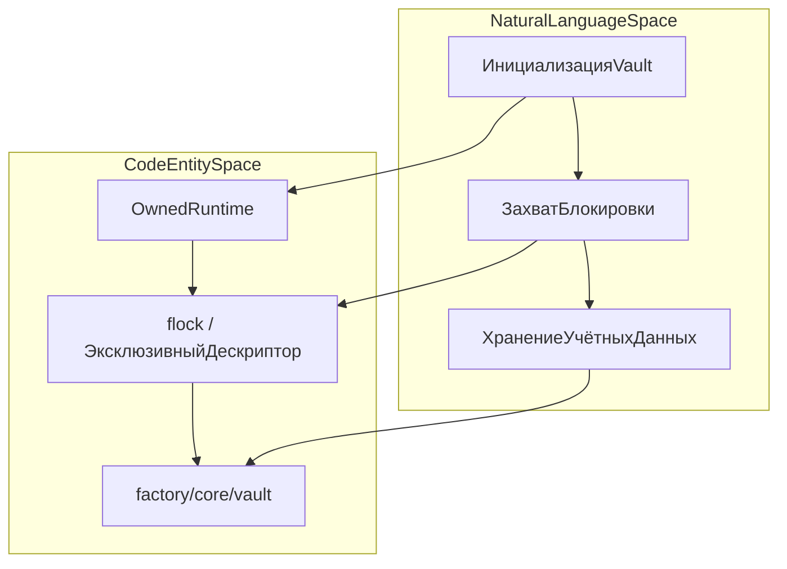
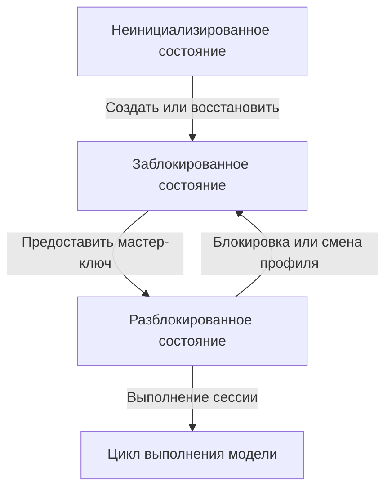
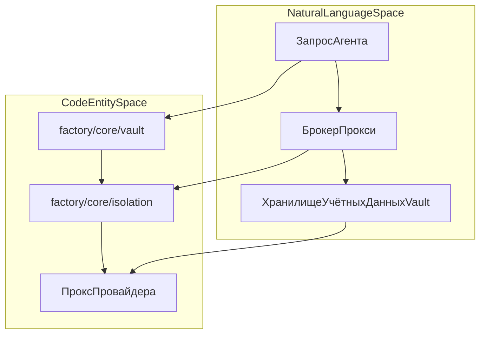

# Vault и секреты

Исходные файлы

Следующие файлы использовались как контекст при генерации этой страницы вики:

- [desktop/main.cjs](desktop/main.cjs)
- [desktop/tests/native/first-run.cjs](desktop/tests/native/first-run.cjs)
- [docs/PROJECT_LAYOUT.md](docs/PROJECT_LAYOUT.md)
- [docs/architecture/ISOLATION.md](docs/architecture/ISOLATION.md)
- [docs/architecture/POLICY.md](docs/architecture/POLICY.md)
- [docs/architecture/RICH_CLI_RENDERING_EXPLAINED.md](docs/architecture/RICH_CLI_RENDERING_EXPLAINED.md)
- [docs/development/CROSS_PLATFORM_DESKTOP.md](docs/development/CROSS_PLATFORM_DESKTOP.md)
- [docs/development/FIRST_RUN_ACCEPTANCE.md](docs/development/FIRST_RUN_ACCEPTANCE.md)
- [factory/core/mobile_bridge/files.py](factory/core/mobile_bridge/files.py)
- [factory/core/opencode_workspace.py](factory/core/opencode_workspace.py)

## Назначение и охват

Подсистема `factory/core/vault` обеспечивает шифрованное хранение учётных данных, управление криптографическими ключами, логику сканеров и детекторов, механизмы редактирования (redaction), разрешения брокера и импорт переменных окружения (`[docs/PROJECT_LAYOUT.md:9]()`). Она гарантирует, что чувствительные токены, API-ключи и приватные параметры остаются защищёнными от несанкционированного чтения как в хост-окружении, так и в изолированных гостях (`[docs/architecture/ISOLATION.md:24]()`). Подсистема тесно интегрирована с жизненным циклом владельца, первичной настройкой приложения (`[docs/development/FIRST_RUN_ACCEPTANCE.md:8]()`) и кроссплатформенными гарантиями файловой блокировки (`[docs/development/CROSS_PLATFORM_DESKTOP.md:13-14]()`).

Источники: `[docs/PROJECT_LAYOUT.md:6-10]`, `[docs/architecture/ISOLATION.md:24-24]`, `[docs/development/FIRST_RUN_ACCEPTANCE.md:6-9]`, `[docs/development/CROSS_PLATFORM_DESKTOP.md:13-15]()`

---

## Архитектура хранения и кроссплатформенная конкурентность

Хранение данных Vault различается по операционным системам, чтобы обеспечить строгую эксклюзивность и предотвратить конкурентную порчу данных или несанкционированное чтение через побочные каналы. 

- **Linux**: владение Vault и взаимное исключение обеспечиваются kernel-арендой `flock` (`[docs/development/CROSS_PLATFORM_DESKTOP.md:13]()`), так что в каждый момент времени читать или изменять хранимые учётные данные может только один авторизованный экземпляр рантайма. Приватные файлы данных по умолчанию получают ограничительные POSIX-права (`[docs/development/CROSS_PLATFORM_DESKTOP.md:14]()`).
- **Windows**: доступ к Vault опирается на эксклюзивный файловый дескриптор, который автоматически освобождается при завершении процесса (`[docs/development/CROSS_PLATFORM_DESKTOP.md:13-14]()`). Списки контроля доступа используют наследуемые DACL для владельца и SYSTEM (`[docs/development/CROSS_PLATFORM_DESKTOP.md:14]()`), блокируя инспекцию со стороны непривилегированных пользователей.

*Рисунок 1: соответствие контрактов владения Vault сущностям кода.*

Источники: `[docs/development/CROSS_PLATFORM_DESKTOP.md:13-15]`, `[docs/PROJECT_LAYOUT.md:8-10]()`

---

## Жизненный цикл владельца и переходы состояний

Жизненный цикл vault управляет доступом к провайдерам моделей и настройкам сессий через явные состояния: неинициализирован, заблокирован, разблокирован (`[docs/development/FIRST_RUN_ACCEPTANCE.md:8]()`). 

При первичном запуске оператор создаёт, восстанавливает или разблокирует vault до сохранения или запроса критичных учётных данных (`[docs/development/FIRST_RUN_ACCEPTANCE.md:8-10]()`). Политики безопасности требуют, чтобы смена профиля, блокировка сессии или таймаут немедленно инвалидировали ожидающие ответы моделей и зависимые bearer-токены (`[docs/development/FIRST_RUN_ACCEPTANCE.md:21-23]()`). При запуске через настольные привязки Electron главный контроллер взаимодействует с операциями vault через управляемые IPC-обработчики (`[desktop/main.cjs:69-79]()`).

*Рисунок 2: жизненный цикл переходов состояний vault.*

Источники: `[docs/development/FIRST_RUN_ACCEPTANCE.md:8-23]`, `[desktop/main.cjs:69-79]()`

---

## Сканеры, детекторы и редактирование

Для предотвращения утечки чувствительных данных vault и окружающие подсистемы применяют строгую проверку путей и содержимого. 

- **Фильтрация workspace**: сканеры снапшотов и инвентаризации явно блокируют приватные каталоги и файлы учётных данных, такие как `.env`, `.aws`, `.ssh`, `.gnupg`, `.codex`, `.claude`, а также расширения приватных ключей (`[factory/core/opencode_workspace.py:13-33]()`).
- **Редактирование файлов**: модули сбора файлов и мобильного моста проверяют вложения и загрузки, вырезая приватные сертификаты (`.pem`, `.key`, `.keystore`, `.jks`) перед передачей или обработкой (`[factory/core/mobile_bridge/files.py:40-42]()`).
- **Применение политик**: файловые политики (`[docs/architecture/POLICY.md:7-16]()`) координируются с хранилищами учётных данных, чтобы сырые ключи никогда не попадали сериализованными в открытые логи задач или экспортируемые чекпоинты.

Источники: `[factory/core/opencode_workspace.py:13-33]`, `[factory/core/mobile_bridge/files.py:40-42]`, `[docs/architecture/POLICY.md:7-16]()`

---

## Разрешения и интеграция брокера

Учётные данные из vault доступны работающим агентам исключительно через брокер-посредника, а не через генеральную инъекцию в окружение (`[docs/architecture/ISOLATION.md:24]()`).

- **Проксирование провайдеров**: адреса вышестоящих сервисов инференса зафиксированы брокер-прокси (`[docs/architecture/ISOLATION.md:29]()`). Пути запросов не могут подменять получателей учётных данных, и цепочки редиректов не пересылают bearer-токены на другие адреса (`[docs/architecture/ISOLATION.md:29-30]()`).
- **Изоляция гостей**: изолированные гостевые окружения не наследуют общие блоки окружения с секретами (`[docs/architecture/ISOLATION.md:24]()`). Вместо этого хостовые сервисы выполняют авторизованные запросы от имени задачи, сохраняя ключи изолированными от векторов эскалации до guest-root (`[docs/architecture/ISOLATION.md:49-60]()`).

*Рисунок 3: интеграция брокера и проксирование учётных данных.*

Источники: `[docs/architecture/ISOLATION.md:24-30]`, `[docs/architecture/ISOLATION.md:49-60]`, `[docs/PROJECT_LAYOUT.md:9-10]()`
