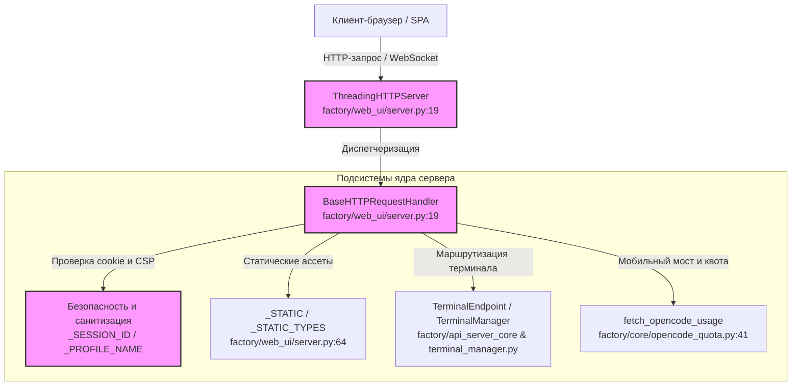
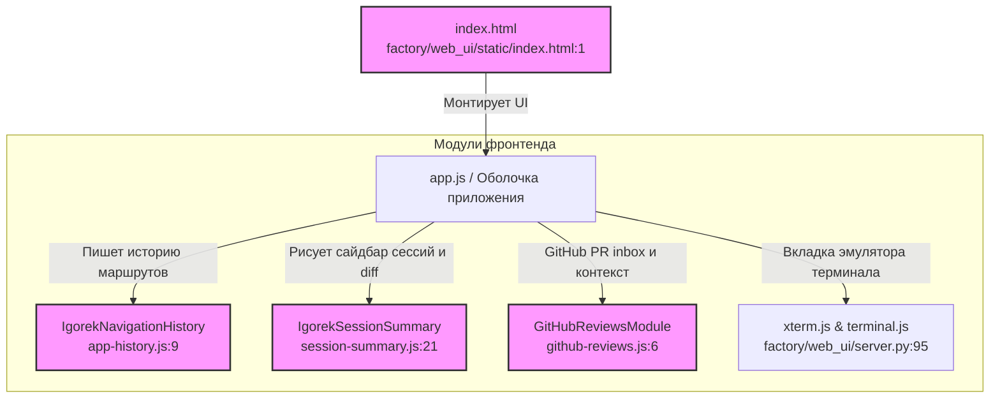

# Ядро API-сервера и Web UI

Исходные файлы

Следующие файлы использовались как контекст при генерации этой страницы вики:

- [factory/web_ui/server.py](factory/web_ui/server.py)
- [factory/web_ui/static/app-history.js](factory/web_ui/static/app-history.js)
- [factory/web_ui/static/app.css](factory/web_ui/static/app.css)
- [factory/web_ui/static/github-reviews.js](factory/web_ui/static/github-reviews.js)
- [factory/web_ui/static/index.html](factory/web_ui/static/index.html)
- [factory/web_ui/static/session-summary.js](factory/web_ui/static/session-summary.js)

Эта страница описывает архитектуру и реализацию ядра Python API-сервера (`factory/api_server_core`), провайдерных рантаймов (интеграции Anthropic и OpenRouter), движков workflow и политик, а также сервера статики (`factory/web_ui/server.py` и `factory/web_ui/static/`).

---

## 1. Рантаймы ядра API-сервера и маршрутизация запросов

Ядро API-сервера принимает запросы от разных интерфейсов (Web UI, CLI-демон, мост Electron-приложения, мобильный мост) и маршрутизирует их к адаптерам выполнения конкретных провайдеров. Оно выполняет перевод API-форматов для внешних клиентов, ожидающих стандартные wire-форматы (например, Anthropic Messages API или chat completions OpenAI/OpenRouter), работая внутри защищённого агентного харнесса.

Слой рантайма координирует многоходовые циклы выполнения инструментов, компакцию контекста и строгие политики безопасности и подтверждений, прежде чем отправить промпты в локальные или удалённые бэкенды моделей.

Источники: `factory/web_ui/server.py:1-62`

---

## 2. Реализация HTTP-сервера Web UI

Бэкенд веб-интерфейса построен на стандартных примитивах HTTP-сервера Python, обёрнутых в многопоточный обработчик запросов. Он реализует кастомные заголовки безопасности, привязку устройства через cookie (`__Host-igorek-device`) и строгую политику Content Security Policy (CSP).

### Ключевые классы сервера и механика маршрутизации
* **`ThreadingHTTPServer`**: управляет параллельным выполнением HTTP-запросов в пуле воркер-потоков [factory/web_ui/server.py:19]().
* **`BaseHTTPRequestHandler`**: расширен для обработки REST-эндпоинтов, раздачи статики, превью артефактов с sandboxed CSP (`_PREVIEW_CSP`) и WebSocket-хендшейков [factory/web_ui/server.py:19](), [factory/web_ui/server.py:54](), [factory/web_ui/server.py:114]().
* **Безопасность и песочница**: строгая санитизация маршрутов регулярными выражениями для ID сессий (`_SESSION_ID`), имён профилей (`_PROFILE_NAME`) и внешних источников (`_EXTERNAL_SOURCES`) — против path traversal и несанкционированного доступа к системе [factory/web_ui/server.py:120](), [factory/web_ui/server.py:124](), [factory/web_ui/server.py:130]().

| Ключ MIME-карты / ассет | Content-Type / назначение |
| :--- | :--- |
| `index.html` | `text/html; charset=utf-8` (главная SPA-оболочка) [factory/web_ui/static/index.html:1](), [factory/web_ui/server.py:69]() |
| `app.js` / `app.css` | Логика приложения и стили UI [factory/web_ui/server.py:70](), [factory/web_ui/server.py:86]() |
| `vendor/xterm.js` / `vendor/xterm.css` | Зависимость-эмулятор терминала для вкладки «Terminal» [factory/web_ui/server.py:95]() |
| `workers/xlsx-worker.js` | Клиентский web worker разбора Excel (SheetJS) [factory/web_ui/server.py:102]() |

Источники: `factory/web_ui/server.py:1-155`

---

## 3. Архитектура статики и одностраничное приложение (SPA)

Веб-интерфейс устроен как одностраничное приложение, которое обслуживает `factory/web_ui/server.py`, а рендерят модульные JavaScript-компоненты из `factory/web_ui/static/`.

### Оболочка приложения и панель навигации
Раскладка (`index.html`) задаёт многоколоночную сетку приложения: панель представлений (`app.sub-rail`), сворачиваемый сайдбар сессий (`sidebar`) и основную рабочую область (`main-panel`) [factory/web_ui/static/index.html:16](). 

* **Панель приложения (`.app-rail`)**: вмещает представления верхнего уровня — Home/Chat, ревью кода (`github-reviews.js`), запланированные задачи и плагины [factory/web_ui/static/index.html:17]().
* **История навигации (`IgorekNavigationHistory`)**: управляется в `app-history.js`, записывает переходы маршрутов (`view`, `session`, `panel`, `tab`, `pull`) и выполняет асинхронное восстановление состояния с эпохами конкурентности [factory/web_ui/static/app-history.js:1]().
* **Сводка сессии (`IgorekSessionSummary`)**: рендерится через `session-summary.js`; компонент отслеживает фоновые процессы, источники файлов, pull request'ы, загрузки и активные изменения diff [factory/web_ui/static/session-summary.js:1]().
* **GitHub-ревью кода (`github-reviews.js`)**: встроенный inbox для фильтрации, поиска и инспекции GitHub Pull Request'ов, проверки валидности состояния аккаунта и генерации безопасного промпт-контекста для AI-ревью кода или разрешения конфликтов слияния [factory/web_ui/static/github-reviews.js:1]().

Источники: `factory/web_ui/static/index.html:1-78`, `factory/web_ui/static/app-history.js:1-33`, `factory/web_ui/static/github-reviews.js:1-28`, `factory/web_ui/static/session-summary.js:1-62`

---

## 4. Диаграммы архитектуры

### Диаграмма 1: сервер Web UI и поток диспетчеризации запросов (Code Entity Space)
Диаграмма сопоставляет концепцию запросов веб-клиента с конкретными классами и модулями в `factory/web_ui/server.py`.

Источники: `factory/web_ui/server.py:1-62`, `factory/web_ui/server.py:120-155`

### Диаграмма 2: компоненты фронтенда SPA и управление состоянием (Code Entity Space)
Диаграмма связывает действия пользователя во фронтенде с JavaScript-модулями в `factory/web_ui/static/`.

Источники: `factory/web_ui/static/index.html:1-78`, `factory/web_ui/static/app-history.js:1-33`, `factory/web_ui/static/github-reviews.js:1-28`, `factory/web_ui/static/session-summary.js:1-62`

## Офлайн-предпросмотр 3D-артефактов

Для HTML-предпросмотра закреплённая глобальная сборка Three.js r128 подставляется локально вместо соответствующих адресов cdnjs, jsDelivr и unpkg. HTML до 4 МиБ обрабатывается в памяти; заменяется не более четырёх подключений. Скачивание исходного файла и документы большего размера не изменяются. SHA-256 библиотеки и лицензия MIT сохранены в vendor. Скрипты data URL разрешены только внутри изолированного sandbox; внешние запросы, доступ к родительскому интерфейсу, формы и Node остаются недоступными. Другие версии библиотек, относительные файлы, сетевые модели и внешние текстуры автоматически не подменяются и не получают сетевого доступа. Исправление открывает соответствующие анимации Three.js без изменения настроек GPU Electron. Нативный CI проверяет изменение кадров 3D в изолированном SwiftShader; это не приёмка физического GPU.
