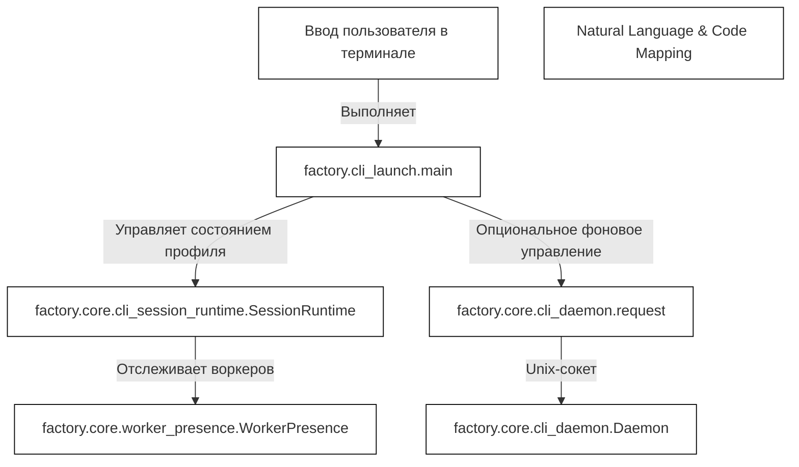
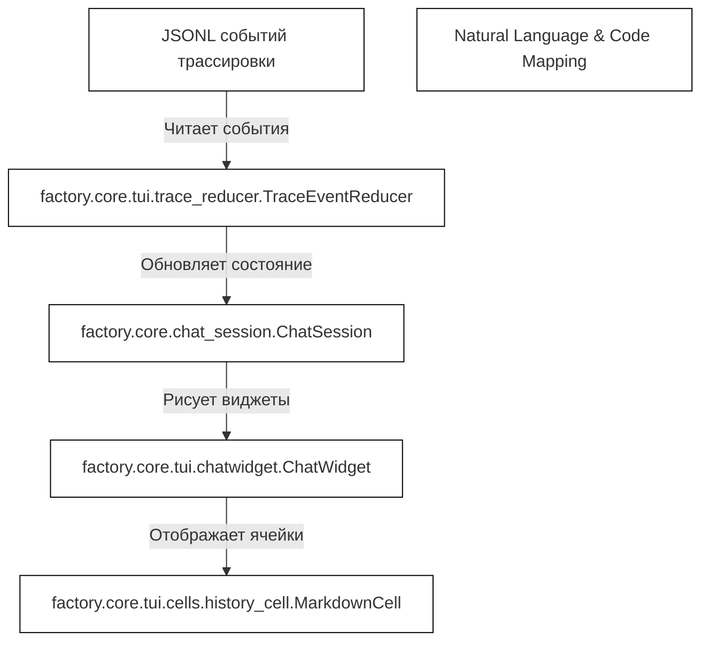

# Терминальный CLI и TUI

Исходные файлы

Следующие файлы использовались как контекст при генерации этой страницы вики:

- [docs/development/CLI_LAUNCH.md](docs/development/CLI_LAUNCH.md)
- [factory/cli_launch.py](factory/cli_launch.py)
- [factory/core/chat_session.py](factory/core/chat_session.py)
- [factory/core/cli_daemon.py](factory/core/cli_daemon.py)
- [tests/test_cli_launch.py](tests/test_cli_launch.py)

## Назначение и охват

Эта страница даёт обзор верхнего уровня интерфейса командной строки `igorek` (CLI) [factory/cli_launch.py:1](), общих CLI-рантаймов владельца [factory/core/cli_daemon.py:1]() и терминального интерфейса (TUI) на базе Rich [factory/core/chat_session.py:1]() в Igorek-Harness. Она описывает, как фоновые лаунчеры взаимодействуют с воркерами, как управляются сессии профилей и как рисуются насыщенные элементы чата в POSIX-терминалах. 

Как родительская страница, документ суммирует ключевые концепции и ссылается на подробные дочерние страницы:
- Подробности о лаунчерах, жизненном цикле демона и рантаймах — см. [Запуск CLI, демон и чат-сессия](#3.1).
- Детали отрисовки виджетов, стриминга и протоколов мыши — см. [Рендеринг TUI и поддержка мыши](#3.2).

Источники: `factory/cli_launch.py:1-12`, `factory/core/cli_daemon.py:1-15`, `factory/core/chat_session.py:1-15`, `docs/development/CLI_LAUNCH.md:1-15`

---

## 3.1. Обзор: запуск CLI, демон и чат-сессия

CLI-подсистема инициализирует интерактивные чат-сессии через реальную консольную точку входа `igorek` [docs/development/CLI_LAUNCH.md:3](). Она поддерживает выбор профиля [docs/development/CLI_LAUNCH.md:16](), возобновление сессий и полноэкранный alt-screen рендеринг либо постоянный inline-скроллбек в терминале [docs/development/CLI_LAUNCH.md:83](). 

Экземпляры клиентов координируются через `SessionRuntime` [tests/test_cli_launch.py:14]() и `worker_presence`, безопасно разделяя воркеров очередей между несколькими терминалами, привязанными к одному каталогу данных [docs/development/CLI_LAUNCH.md:25](). Для неинтерактивного или общего фонового выполнения опциональный владелец-локальный `Daemon` [factory/core/cli_daemon.py:69]() обслуживает фоновые очереди через приватный Unix-сокет с проверкой UID пира [factory/core/cli_daemon.py:45]().

Полная техническая документация по выполнению лаунчера, управлению сессиями и командам демона — см. [Запуск CLI, демон и чат-сессия](#3.1).

Источники: `factory/cli_launch.py:12-87`, `factory/core/cli_daemon.py:45-75`, `tests/test_cli_launch.py:14-65`, `docs/development/CLI_LAUNCH.md:1-45`

---

## 3.2. Обзор: рендеринг TUI и поддержка мыши

Терминальный UI построен на Rich и кастомных виджетах из `factory/core/tui/` [factory/core/chat_session.py:71](). `ChatSession` координирует нажатия клавиш пользователя, slash-команды [factory/core/chat_session.py:81](), диспетчеризацию фоновых задач и стриминг событий трассировки в реальном времени [factory/core/chat_session.py:121]().

Рендеринг опирается на модульные типы ячеек — `MarkdownCell`, `ReasoningCell`, `ToolCallGroupCell` [factory/core/chat_session.py:72]() — в связке с `TraceEventReducer` [factory/core/chat_session.py:77](), который превращает сырые JSONL-потоки трассировки бэкенда в структурированные кадры терминала. Протоколы мыши, обработка выделения и интеграции с буфером обмена работают асинхронно, сохраняя отзывчивость промпта.

Подробная документация по деревьям виджетов, рендерингу markdown и diff, протоколам мыши и потокам буфера обмена — см. [Рендеринг TUI и поддержка мыши](#3.2).

Источники: `factory/core/chat_session.py:71-79`, `factory/core/chat_session.py:121-137`, `docs/development/CLI_LAUNCH.md:83-110`
