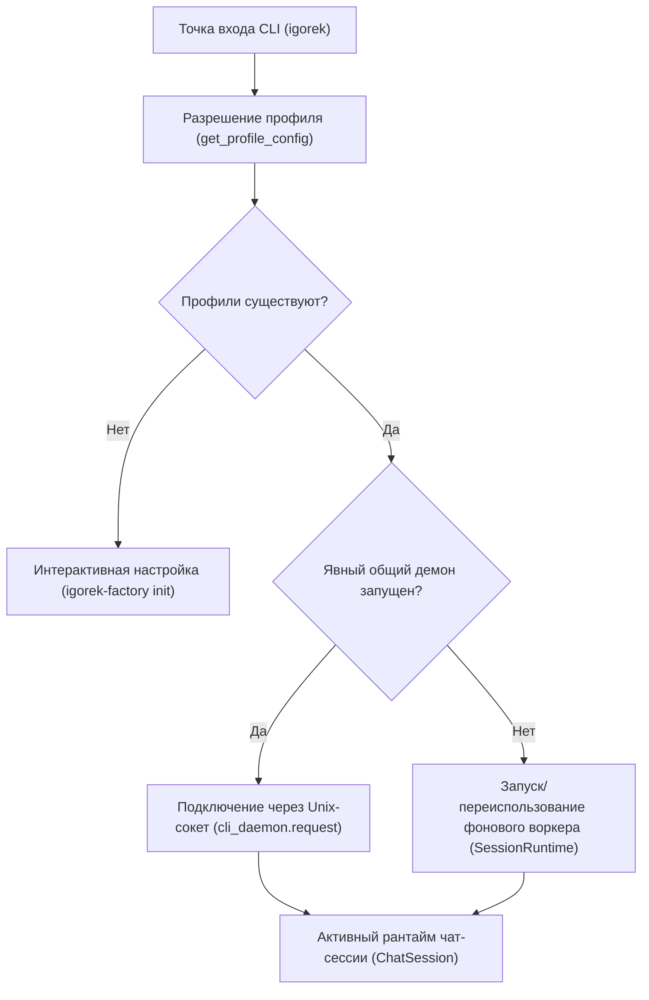
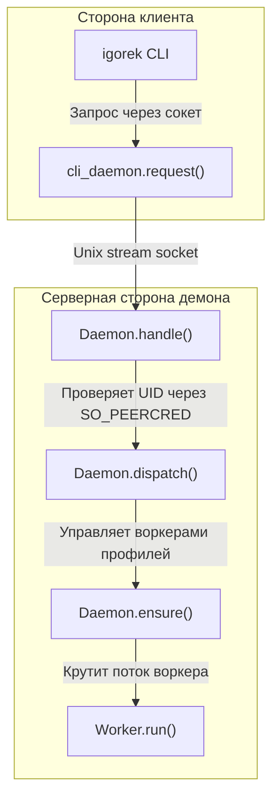

# Запуск CLI, демон и чат-сессия

<details>
<summary>Исходные файлы</summary>

Следующие файлы использовались как контекст при генерации этой страницы вики:

- [docs/development/CLI_LAUNCH.md](docs/development/CLI_LAUNCH.md)
- [factory/core/chat_session.py](factory/core/chat_session.py)
- [factory/core/cli_chat_active.py](factory/core/cli_chat_active.py)
- [factory/core/cli_classic.py](factory/core/cli_classic.py)
- [factory/core/cli_daemon.py](factory/core/cli_daemon.py)
- [factory/core/cli_session_runtime.py](factory/core/cli_session_runtime.py)
- [tests/test_cli_launch.py](tests/test_cli_launch.py)

</details>


## Назначение и охват
Эта страница описывает жизненный цикл запуска терминального CLI (`igorek`), фоновый рантайм сессий с подсчётом ссылок (`SessionRuntime`), явный владелец-локальный фоновый демон (`Daemon`) и режимы выполнения чат-сессий (классический и активный чат-рантаймы, slash-команды, очереди профилей, обработка отмены).

---

## 1. Запуск CLI и последовательность старта
Установщик хост-инструментов создаёт независимую консольную точку входа `igorek` `[docs/development/CLI_LAUNCH.md:1-7]()`. CLI-фронтенд поддерживает стандартный полноэкранный режим с захватом мыши или inline-режим промпта через `--no-alt-screen` `[docs/development/CLI_LAUNCH.md:83-86]()`.

- **Разрешение профиля:** при первом запуске, если профилей пользователя нет, предлагается интерактивная настройка `[docs/development/CLI_LAUNCH.md:16-18]`. Единственный сконфигурированный профиль выбирается автоматически; иначе пользователь выбирает из доступных, причём последний удачный выбор запоминается `[docs/development/CLI_LAUNCH.md:17-18]`.
- **Флаги командной строки:** принимаются `--profile NAME`, `--resume SESSION_ID`, `--no-alt-screen` и `--data-dir PATH` `[docs/development/CLI_LAUNCH.md:8-14]`, `[docs/development/CLI_LAUNCH.md:55-57]`.


*Источники: `docs/development/CLI_LAUNCH.md:1-127`, `factory/core/cli_session_runtime.py:19-64`*

---

## 2. Интерактивное владение и фоновые рантаймы сессий
Фоновые клиенты управляют воркерами через подсчёт ссылок и файловые блокировки на уровне ОС внутри каталога данных профиля `[factory/core/cli_session_runtime.py:1-112]`.

### Ключевые компоненты
- `SessionRuntime`: расположен в `[factory/core/cli_session_runtime.py:19-112]`, управляет жизненным циклом клиента, выбором профиля и порождением процессов.
- **Блокировки клиентов:** каждый активный клиент держит эксклюзивную файловую блокировку внутри `profile_directory(profile) / "clients"` `[factory/core/cli_session_runtime.py:33-37]()`.
- **Сериализация старта:** эксклюзивная блокировка `startup.lock` предотвращает гонки при инициализации или остановке воркера `[factory/core/cli_session_runtime.py:39-40]()`.
- **Остановка воркера:** когда последний клиент отпускает блокировку, управляемому фоновому воркер-процессу подаётся сигнал остановки `[factory/core/cli_session_runtime.py:92-105]()`.

```mermaid
graph TD
    subcol["Natural Language & Code Entity Space"]
    CLI["Запуск CLI-клиента"] -->|Вызывает select()| SR["SessionRuntime (factory/core/cli_session_runtime.py)"]
    SR -->|Проверяет общий демон| DAEMON{"Демон запущен?"}
    DAEMON -->|Да| REQ["cli_daemon.request()"]
    DAEMON -->|Нет| LOCK["Захват startup.lock и блокировки клиента"]
    LOCK -->|Порождает при необходимости| W["Процесс воркера (factory/core/worker.py)"]
    W -->|Мониторит присутствие| WP["worker_presence.py"]
```
*Источники: `factory/core/cli_session_runtime.py:19-156`, `factory/core/worker_presence.py`*

---

## 3. Явный общий фоновый демон
Для неинтерактивных или долгоживущих сценариев работы профиля можно явно запустить демон `[docs/development/CLI_LAUNCH.md:46-82]`.

### Команды жизненного цикла
- `igorek app-server daemon start`: идемпотентно запускает фоновый демон `[docs/development/CLI_LAUNCH.md:51-59]`.
- `igorek app-server daemon stop`: отказывается останавливаться, если активны задачи или заняты блокировки выполнения (`Daemon.dispatch()`) `[factory/core/cli_daemon.py:145-161]()`.
- `igorek app-server daemon version`: возвращает статус работы, версию, обслуживаемые профили и состояние планировщика `[factory/core/cli_daemon.py:133-135]()`.

### Безопасность и IPC
- **Unix Domain Socket:** обмен идёт строго через владелец-локальный Unix-сокет с ограниченными JSON-кадрами (`LIMIT = 8 * 1024 * 1024`) `[factory/core/cli_daemon.py:25-42]()`.
- **Проверка пиринговых учётных данных:** проверки `SO_PEERCRED` убеждаются, что UID подключающегося процесса совпадает с `os.getuid()` `[factory/core/cli_daemon.py:54-57]()`.


*Источники: `factory/core/cli_daemon.py:1-277`*

---

## 4. Выполнение чат-сессии: классический и активный рантаймы
Чат-сессии обрабатывают ввод пользователя, отображение выполнения инструментов и slash-команды.

### Slash-команды и переключение профилей
- Команды вроде `/profile NAME` меняют активный маршрут профиля, сбрасывают предыдущие переопределения модели, сбрасывают правила подтверждений сессии и обновляют метаданные истории `[docs/development/CLI_LAUNCH.md:19-21]`, `[tests/test_cli_launch.py:131-156]`.
- Другие команды: `/help`, `/exit`, `/clear`, `/history`, `/resume`, `/model` и `/theme` `[factory/core/chat_session.py:81-101]()`.

### Режимы рантайма
- **Активный чат-рантайм (`cli_chat_active.py`):** кастомные раскладки `prompt_toolkit`, динамическая высота textarea по переносу текста и живой rich-вывод для активных ходов модели `[factory/core/cli_chat_active.py:1-177]`.
- **Классический режим шапки (`cli_classic.py`):** компактная терминальная шапка с профилем, моделью, версией и рабочим каталогом при установленном `IGOREK_TUI_CLASSIC_STYLE=legacy` `[docs/development/CLI_LAUNCH.md:83-97]`, `[factory/core/cli_classic.py:1-17]`.
- **Отмена (`Ctrl+C`):** отменяет только текущую задачу вызвавшего клиента, не затрагивая других параллельных клиентов профиля или потоки выполнения демона `[docs/development/CLI_LAUNCH.md:35-37]`, `[docs/development/CLI_LAUNCH.md:74-75]`.

| Возможность | Классический / inline-режим (`--no-alt-screen`) | Полноэкранный TUI (по умолчанию) |
| :--- | :--- | :--- |
| **Скроллбек терминала** | Сохраняет обычный скроллбек | Использует альтернативный экран |
| **Захват мыши** | Отключён | Включён для выделения и кликов |
| **Стиль шапки** | Компактная шапка или legacy (`cli_classic.py`) | Интегрированная строка статуса и виджеты |
| **Цикл событий** | Однопоточный цикл промпта с rich-выводом | Раскладка `prompt_toolkit` с `ChatWidget` |

*Источники: `docs/development/CLI_LAUNCH.md:83-97`, `factory/core/chat_session.py:1-214`, `factory/core/cli_classic.py:1-17`, `factory/core/cli_chat_active.py:1-177`*
