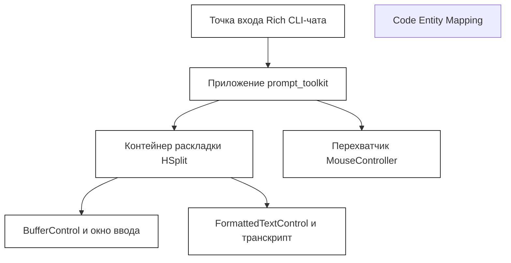
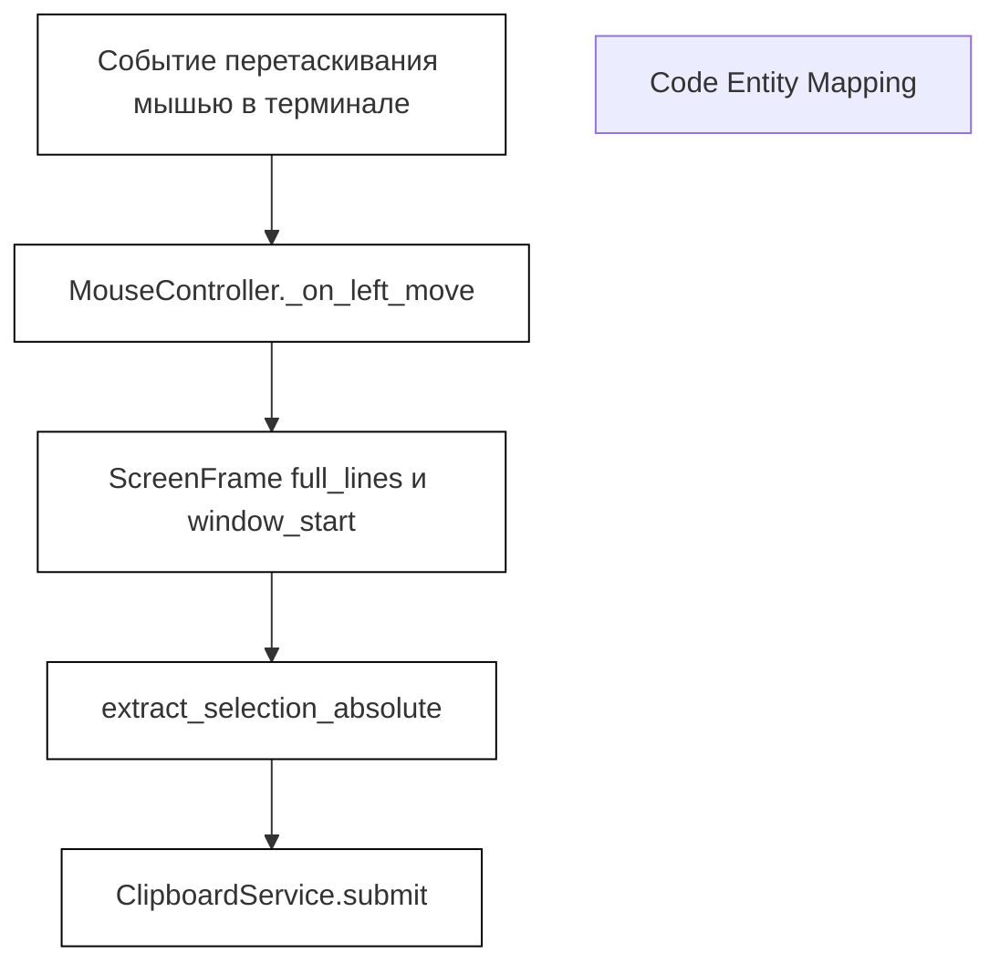

# Рендеринг TUI и поддержка мыши

Исходные файлы

Следующие файлы использовались как контекст при генерации этой страницы вики:

- [factory/core/cli_chat_rich.py](factory/core/cli_chat_rich.py)
- [factory/core/tui/mouse_clipboard.py](factory/core/tui/mouse_clipboard.py)
- [factory/core/tui/mouse_controller.py](factory/core/tui/mouse_controller.py)
- [tests/test_mouse_selection_absolute.py](tests/test_mouse_selection_absolute.py)
- [tests/test_tui_mouse.py](tests/test_tui_mouse.py)

## Назначение и охват
Этот раздел описывает архитектуру рендеринга терминального интерфейса (TUI) и расширенную поддержку мыши в Python-ядре Igorek-Harness. Будучи портом архитектуры Codex Rust TUI на Python, он связывает приложения `prompt_toolkit` и рендеринг на `rich` с продвинутым парсером протокола мыши, абсолютным выделением за пределами экрана, обработкой жестов автопрокрутки и сериализованным потокобезопасным сервисом буфера обмена.

Источники: `[factory/core/cli_chat_rich.py:1-46]`, `[factory/core/tui/mouse_clipboard.py:1-15]`, `[factory/core/tui/mouse_controller.py:1-16]()` 

---

## 1. Архитектура TUI и интеграция с prompt_toolkit
Подсистема TUI координирует интерактивные чат-сессии через компоненты раскладок `prompt_toolkit` (`Layout`, `HSplit`, `Window`, `BufferControl`, `FormattedTextControl`), управляемые внутри `factory/core/cli_chat_rich.py`. Она интегрирует промпты простоя, экраны активного выполнения, ячейки трассировки рассуждений и диалоги подтверждений, динамически связывая символы и раскладки приложения.

*Диаграмма 1: мост раскладки TUI и интеграции приложения*

Источники: `[factory/core/cli_chat_rich.py:22-123]()`

---

## 2. Протокол мыши и разбор SGR
Разбор ввода мыши реализован через расширение слежения за мышью SGR (1006). Парсер превращает сырые escape-последовательности в структурированные события мыши, различая клики, отпускания, движения и колёсико, и извлекая модификаторы координат (`shift`, `ctrl`).

- **Ключевая функция**: `parse_sgr_mouse_sequence()` разбирает последовательности форматов SGR вроде `\x1b[<button;x;yM` (нажатие) или `\x1b[<button;x;ym` (отпускание).
- **Преобразование координат**: переводит 1-базные координаты терминала в 0-базные индексы приложения.

Источники: `[tests/test_tui_mouse.py:49-92]()`

---

## 3. Захват мыши и прокси вывода
Потоки вывода терминала оборачиваются, чтобы внедрять escape-последовательности включения и выключения отчётов мыши, не нарушая стандартные операции VT100.

- **Классы**: `MouseCaptureOutput` и `wrap_output_for_mouse()` в `factory/core/tui/mouse_output.py` проксируют стандартные потоки вывода `prompt_toolkit`.
- **Escape-последовательности**: динамически эмитируют `ENABLE_SEQUENCES` при старте и `DISABLE_SEQUENCES` при завершении.

Источники: `[tests/test_tui_mouse.py:94-134]()`

---

## 4. Представление кадров и механика выделения
Механика выделения опирается на геометрию кадров, снятую при рендеринге раскладки.

- **Классы и структуры**: 
  - `ScreenFrame`: хранит видимые строки (`FrameRow`), смещения прокрутки окна (`window_start`) и полную историю транскрипта (`full_lines`).
  - `Selection`: определяет координаты якоря и фокуса `(x1, y1, x2, y2)`.
- **Функции**:
  - `extract_selection()`: извлекает видимую область, вычищая ANSI-форматирование, корректно обрабатывая границы широких символов и комбинируемые знаки.
  - `extract_selection_absolute()`: позволяет выделять в координатах абсолютного транскрипта, захватывая строки, уже ушедшие за пределы видимого окна.

*Диаграмма 2: поток данных абсолютного выделения и копирования*

Источники: `[factory/core/tui/mouse_controller.py:134-144]`, `[tests/test_mouse_selection_absolute.py:20-56]`, `[tests/test_tui_mouse.py:135-183]()`

---

## 5. Контроллер мыши и координация жестов
Класс `MouseController` — единая точка интеграции поддержки мыши в TUI. Он отслеживает намерение пользователя (`user_enabled` и переменные окружения вроде `IGOREK_TUI_MOUSE`), состояния жестов (`GestureState`) и координирует автопрокрутку при drag-and-drop, когда выделение упирается в верхний или нижний край области просмотра.

- **Отслеживание жестов**: управляет состояниями нажатия, движения и отпускания (`_on_left_press`, `_on_left_move`, `_on_left_release`).
- **Обработка колёсика**: переводит щелчки колёсика в настраиваемые прыжки строк через `IGOREK_TUI_WHEEL_LINES`.

Источники: `[factory/core/tui/mouse_controller.py:52-160]`, `[tests/test_mouse_selection_absolute.py:80-130]()`

---

## 6. Интеграция буфера обмена и сериализация
Копирование выделения в системный буфер обмена может включать блокирующие вызовы подпроцессов (`arboard`, `wl-copy`, `xclip`, `xsel` или утилиты WSL PowerShell). Чтобы гонки от медленных или налагающихся операций копирования не вредили, `ClipboardService` сериализует запросы монотонными билетами.

- **Класс**: `ClipboardService` в `factory/core/tui/mouse_clipboard.py`.
- **Управление конкурентностью**: выдаёт монотонно растущий билет через `next_ticket()`. Фоновые воркер-потоки сверяют свой стартовый билет с `_latest_ticket`, отбрасывая устаревшие операции копирования.
- **Категоризация бэкендов**:
  - `_LOCAL_BACKENDS`: подтверждённые локальные инструменты буфера обмена (`arboard`, `wl-copy`, `xclip`, `xsel`, `wsl`).
  - `_TERMINAL_BACKENDS`: эскейп-последовательности, управляемые терминалом (`osc52`, `tmux`), где доставка не может быть проверена локально.

Источники: `[factory/core/tui/mouse_clipboard.py:1-116]()`
