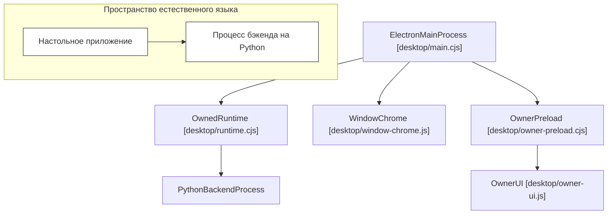

# Настольное приложение Electron

Используемые исходные файлы

Для генерации этой страницы вики использовались следующие файлы:

- [desktop/main.cjs](desktop/main.cjs)
- [desktop/owner-preload.cjs](desktop/owner-preload.cjs)
- [desktop/owner-ui.js](desktop/owner-ui.js)
- [desktop/runtime.cjs](desktop/runtime.cjs)
- [desktop/tests/native/first-run.cjs](desktop/tests/native/first-run.cjs)
- [desktop/tests/owner-busy.test.cjs](desktop/tests/owner-busy.test.cjs)
- [desktop/tests/runtime.test.cjs](desktop/tests/runtime.test.cjs)
- [factory/core/mobile_bridge/files.py](factory/core/mobile_bridge/files.py)
- [factory/core/opencode_workspace.py](factory/core/opencode_workspace.py)

Эта страница даёт высокоуровневый обзор подсистемы `desktop/` в Igorek-Harness, реализующей настольное приложение на Electron. Настольный клиент управляет оформлением окна, нативными интеграциями, защищёнными поверхностями межпроцессного взаимодействия (IPC), административным интерфейсом владельца и жизненным циклом размещаемой среды исполнения бэкенда агента на Python.

Подробные технические разборы — на дочерних страницах:
- [Главный процесс и обработчики IPC](#4.1)
- [Управляемая среда исполнения и интерфейс владельца](#4.2)
- [Обновления релизов и что нового](#4.3)

---

## Архитектура десктопа и обзор компонентов

Архитектура десктопа разделяет привилегированную оркестрацию в главном процессе и изолированные фреймы рендерера. Главная точка входа `desktop/main.cjs` координирует жизненный цикл Electron-приложения, создаёт окна, регистрирует обработчики IPC и порождает управляемый Python-бэкенд с помощью `OwnedRuntime`, определённого в `desktop/runtime.cjs`.

Источники: `[desktop/main.cjs:1-58]`, `[desktop/runtime.cjs:68-85]`, `[desktop/owner-preload.cjs:1-10]()`

---

## 4.1 Главный процесс и обработчики IPC

Главный процесс управляет фреймами окон, меню приложения, уведомлениями ОС, пользовательскими горячими клавишами и диагностическими окнами. Он выстраивает защищённые IPC-мосты через `ipcMain.handle`, ограничивая возможности рендерера и проверяя origins фреймов.

Подробная документация по каталогу IPC-каналов, внедрению оформления окна, меню, уведомлениям, горячим клавишам и диагностике — в разделе [Главный процесс и обработчики IPC](#4.1).

Источники: `[desktop/main.cjs:73-129]()`

---

## 4.2 Управляемая среда исполнения и интерфейс владельца

Настольное приложение размещает ядро агента на Python как управляемый дочерний процесс. `OwnedRuntime` (`[desktop/runtime.cjs:68-109]()`) порождает Python-бэкенд, обрабатывает его потоки stdout/stderr, формирует изолированные переменные окружения (`[desktop/runtime.cjs:15-54]()`) и маршрутизирует запросы владельца. Интерфейс владельца (`desktop/owner-ui.js`) и его защищённый preload-мост (`desktop/owner-preload.cjs`) предоставляют панели настроек для секретов хранилища, статусов плагинов, режимов выполнения и сценариев восстановления.

Подробности о порождении управляемого бэкенда, панелях интерфейса владельца, состояниях занятости, настройках хранилища и файлах восстановления — в разделе [Управляемая среда исполнения и интерфейс владельца](#4.2).

Источники: `[desktop/runtime.cjs:68-109]`, `[desktop/owner-preload.cjs:29-86]()`

---

## 4.3 Обновления релизов и что нового

В настольном приложении есть встроенный конвейер проверки, загрузки и установки релизов. Оно открывает диалоги обновления (`desktop/release-updates-ui.cjs`) и окна отображения прогресса (`desktop/release-progress.cjs`), помогающие пользователям безопасно обновляться и работать с историей версий приложения.

Подробности о процессе обновления, вспомогательных скриптах установки релиза, окнах прогресса и ресурсах заметок о релизе — в разделе [Обновления релизов и что нового](#4.3).

Источники: `[desktop/main.cjs:5-8]()`
