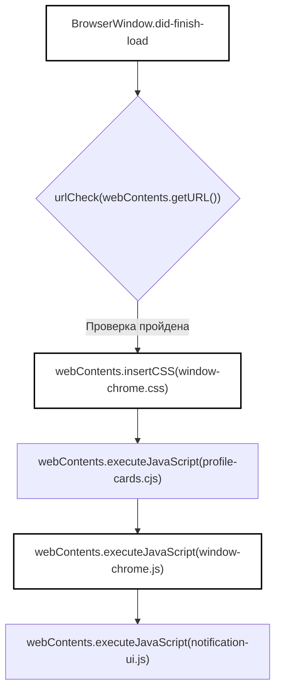

# Главный процесс и обработчики IPC

<details>
<summary>Используемые исходные файлы</summary>

Для генерации этой страницы вики использовались следующие файлы:

- [desktop/main.cjs](desktop/main.cjs)
- [desktop/packaging/bundle_sources.py](desktop/packaging/bundle_sources.py)
- [desktop/tests/completion-sound.test.cjs](desktop/tests/completion-sound.test.cjs)
- [desktop/tests/github-reviews.test.cjs](desktop/tests/github-reviews.test.cjs)
- [desktop/tests/native/first-run.cjs](desktop/tests/native/first-run.cjs)
- [desktop/tests/notifications.test.cjs](desktop/tests/notifications.test.cjs)
- [desktop/window-chrome.css](desktop/window-chrome.css)
- [desktop/window-chrome.js](desktop/window-chrome.js)
- [desktop/window-menu.cjs](desktop/window-menu.cjs)
- [docs/THIRD_PARTY_NOTICES.md](docs/THIRD_PARTY_NOTICES.md)
- [docs/licenses/OPENCODE-ICON-LICENSE.txt](docs/licenses/OPENCODE-ICON-LICENSE.txt)
- [factory/core/mobile_bridge/files.py](factory/core/mobile_bridge/files.py)
- [factory/core/opencode_workspace.py](factory/core/opencode_workspace.py)
- [factory/web_ui/static/app.js](factory/web_ui/static/app.js)

</details>


## Назначение и область охвата

Главный процесс настольного Electron-приложения, ядром которого служит `desktop/main.cjs`, выступает привилегированным оркестратором десктоп-среды исполнения Igorek [desktop/main.cjs:1-41](). Он управляет экземплярами Electron `BrowserWindow`, обеспечивает границы безопасности через строгую проверку фреймов, маршрутизирует каналы межпроцессного взаимодействия (IPC) между представлениями рендерера и хост-сервисами, внедряет динамическое оформление окна [desktop/main.cjs:94-108]() и координирует системные интеграции: нативные меню приложения [desktop/window-menu.cjs:1-48](), уведомления рабочего стола [desktop/main.cjs:80-92](), глобальные горячие клавиши [desktop/main.cjs:70]() и диагностику производительности [desktop/main.cjs:48-49]().

Источники: [desktop/main.cjs:1-49](), [desktop/main.cjs:70-108](), [desktop/window-menu.cjs:1-48]()

---

## Каталог IPC-каналов и архитектура безопасности

Главный процесс регистрирует несколько защищённых обработчиков IPC через Electron `ipcMain.handle` [desktop/main.cjs:73](). Чтобы представления рендерера не могли отправлять несанкционированные команды хосту, каждый вызов канала проходит через проверку вроде `trustedChromeWindow(event)` [desktop/main.cjs:110-115]() или проверку доверия сессии [desktop/main.cjs:76]().

| IPC-канал | Направление | Функция / обработчик | Защита / валидация |
| :--- | :--- | :--- | :--- |
| `igorek:completion-sound` | Рендерер ⇄ Main | `completionSound.state()`, `claim()`, `set()` [desktop/main.cjs:73-79]() | `trustedChromeWindow(event)` для чтения/захвата; `isOwnerFrame()` для изменения настроек [desktop/main.cjs:76-77]() |
| `igorek:notifications` | Рендерер ⇄ Main | `notificationStore` (`snapshot`, `add`, `read`, `clear`) [desktop/main.cjs:80-92]() | `trustedChromeWindow(event)` проверяет корректность URL фрейма и отправителя [desktop/main.cjs:110-115]() |
| `igorek:window-control` | Рендерер → Main | `target.minimize()`, `maximize()`, `close()` [desktop/main.cjs:116-122]() | `trustedChromeWindow(event)` [desktop/main.cjs:110-115]() |
| `igorek:window-menu` | Рендерер → Main | `menu.popup({ window: target, x, y })` [desktop/main.cjs:123-129]() | Проверяет метку меню и целочисленные координаты в пределах области контента [desktop/main.cjs:126-127]() |

### Безопасность и маршрутизация IPC: поток данных

```mermaid
graph TD
    subcode["Пространство сущностей кода"]
        IPC["ipcMain.handle"] --> Guard["trustedChromeWindow(event)"]
        Guard --> Check{"chromeWindows.get(event.sender)"}
        Check -->|Валидно| Handler["CompletionSound / NotificationStore"]
        Check -->|Невалидно| Deny["Throw Error('Доступ запрещен.')"]
    end

    style IPC fill:none,stroke:#000,stroke-width:2px
    style Guard fill:none,stroke:#000,stroke-width:2px
    style Handler fill:none,stroke:#000,stroke-width:2px
```

Источники: [desktop/main.cjs:73-129](), [desktop/tests/completion-sound.test.cjs:65-81]()

---

## Оформление окна и внедрение в DOM

Окна десктопа не полагаются на стандартное оформление фрейма ОС. Вместо этого `desktop/main.cjs` применяет собственные стили кнопок управления окном [desktop/main.cjs:98]() и внедряет клиентское поведение интерфейса по завершении загрузки страницы (`did-finish-load`) [desktop/main.cjs:100-108]().

Функция `installWindowChrome(target, urlCheck)` подключает слушатели звуковых уведомлений [desktop/main.cjs:96](), отслеживает активные browser contents в карте `chromeWindows` [desktop/main.cjs:97]() и программно внедряет таблицы стилей и скрипты [desktop/main.cjs:102-106]():
* `window-chrome.css`: задаёт раскладку собственной строки заголовка (`#igorek-window-bar`), области перетаскивания, стили переключения сайдбара и панели всплывающих уведомлений [desktop/window-chrome.css:1-40]().
* `profile-cards.cjs`: отрисовывает карточки активных профилей и индикаторы окружения среды исполнения [desktop/main.cjs:104]().
* `window-chrome.js`: реализует DOM-элементы кнопок управления окном (свернуть, развернуть, закрыть), кнопок истории навигации и триггеров всплывающего меню [desktop/window-chrome.js:1-33]().
* `notification-ui.js`: подключает бейджи уведомлений и выпадающие лотки [desktop/main.cjs:106]().

### Конвейер внедрения оформления окна



Источники: [desktop/main.cjs:94-109](), [desktop/window-chrome.js:1-43](), [desktop/window-chrome.css:1-40]()

---

## Меню приложения и горячие клавиши

Меню приложения определены в `desktop/window-menu.cjs` через `windowMenu(actions, tracing, bindings)` [desktop/window-menu.cjs:2](). Структура меню делится на четыре основных подменю:
1. **Файл (File)**: новое окно, новая сессия, открыть папку, браузер, вкладка ChatGPT, настройки, закрыть окно и выход [desktop/window-menu.cjs:10-18]().
2. **Правка (Edit)**: стандартные операции редактирования текста (отменить, повторить, вырезать, копировать, вставить, удалить, выделить всё) [desktop/window-menu.cjs:19-23]().
3. **Вид (View)**: переключение сайдбара, проверки панелей, терминал, фокус на композере, отправка сообщений, навигация по чатам (предыдущий/следующий/закрепить/недавние чаты), управление масштабом и полноэкранный режим [desktop/window-menu.cjs:24-38]().
4. **Справка (Help)**: горячие клавиши, статус системы, диспетчер задач, трассировка производительности, «Что нового» и «О программе» [desktop/window-menu.cjs:39-45]().

Глобальные и локальные привязки горячих клавиш управляются `ShortcutStore` [desktop/main.cjs:70]() и сверяются с настраиваемыми пользователем сочетаниями клавиш [desktop/main.cjs:17]().

Источники: [desktop/window-menu.cjs:1-48](), [desktop/main.cjs:17](), [desktop/main.cjs:70]()

---

## Уведомления, звук и диагностика

Десктопный харнесс интегрирует в главном процессе постоянные фоновые хранилища и средства диагностики:
* **`NotificationStore`**: сохраняет системные уведомления в `notifications.json` внутри `userData` [desktop/main.cjs:71](). Поддерживает добавление, чтение, очистку и рассылку событий изменений всем активным `chromeWindows` [desktop/main.cjs:80-92]().
* **`CompletionSound`**: управляет настройками синтезированного сигнала завершения задачи, хранящимися в `completion-sound.json` [desktop/main.cjs:72](). Отслеживает состояния фокуса и расфокусировки окна, чтобы решить, проигрывать ли сигнал по завершении фоновых задач [desktop/tests/completion-sound.test.cjs:35-47]().
* **Диагностика производительности**: главный процесс координирует Electron API `contentTracing` [desktop/main.cjs:1](). Через меню «Справка» [desktop/window-menu.cjs:43]() операторы могут запускать, останавливать и выгружать трассировки производительности для диагностического анализа.

Источники: [desktop/main.cjs:48-49](), [desktop/main.cjs:71-72](), [desktop/main.cjs:80-92](), [desktop/tests/completion-sound.test.cjs:35-47]()
