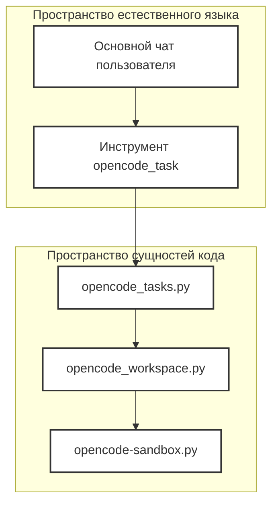
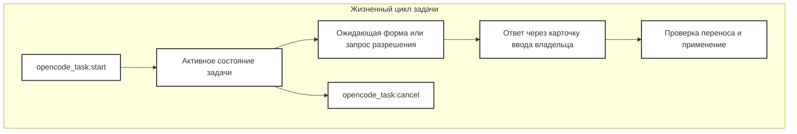
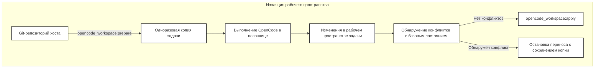
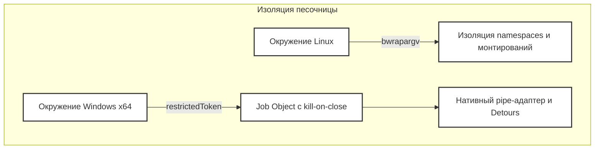

# Подсистема делегирования OpenCode

Используемые исходные файлы

Для генерации этой страницы вики использовались следующие файлы:

- [docs/architecture/OPENCODE_DELEGATION.md](docs/architecture/OPENCODE_DELEGATION.md)
- [docs/images/opencode-delegation-en.png](docs/images/opencode-delegation-en.png)
- [docs/images/opencode-delegation-en.svg](docs/images/opencode-delegation-en.svg)
- [docs/images/opencode-delegation-ru.png](docs/images/opencode-delegation-ru.png)
- [docs/images/opencode-delegation-ru.svg](docs/images/opencode-delegation-ru.svg)

## Назначение и область охвата

Подсистема делегирования OpenCode позволяет настольным платформам Linux и Windows x64 делегировать фоновые задачи по написанию кода установленному сервису OpenCode, сохраняя непрерывность основного диалога [docs/architecture/OPENCODE_DELEGATION.md:1-7](). Ядро-оркестратор открывает инструмент `opencode_task` с примитивами запуска, получения статуса и отмены [docs/architecture/OPENCODE_DELEGATION.md:5-7](). 

Эта родительская страница даёт общий обзор того, как фоновые сессии помещаются в песочницу, как кодовые рабочие пространства изолируются и снапшотятся и как управляется жизненный цикл задач между процессами. Полные технические детали — в специализированных дочерних страницах.

*Рисунок 1: Связывание запросов задач на естественном языке с сущностями оркестрации на Python.*

Источники: `docs/architecture/OPENCODE_DELEGATION.md:1-14`

---

## 5.1 OpenCodeService и жизненный цикл задачи

Фоновые задачи по коду работают как устойчивые записи, а не как активные ходы в основной очереди диалога [docs/architecture/OPENCODE_DELEGATION.md:38-42](). Фоновый монитор среды исполнения опрашивает исходы сессий, таймлайны, ожидающие запросы форм и промпты на разрешение, безопасно выводя их через интерфейс карточки ввода основного чата [docs/architecture/OPENCODE_DELEGATION.md:38-45](). 

Система гарантирует, что проза модели никогда случайно не ответит на промпты разрешений или вопросы пользователя [docs/architecture/OPENCODE_DELEGATION.md:41-44](). Ответ напрямую в OpenCode или через хостовый интерфейс резолвит конкретный ID запроса, обеспечивая строгую транзакционную изоляцию между циклами агента [docs/architecture/OPENCODE_DELEGATION.md:41-45](). Подробная архитектурная документация по установке сервиса, управлению шлюзом, режимам KVM и песочницы, состояниям задач — в разделе [OpenCodeService и жизненный цикл задачи](#5.1).

*Рисунок 2: Переходы состояний задачи OpenCode и контуры обратной связи с пользователем.*

Источники: `docs/architecture/OPENCODE_DELEGATION.md:38-60`

---

## 5.2 Снапшоты рабочего пространства и проверка переноса

Чтобы не допустить нежелательных изменений в хостовых проектах, подсистема снимает активное Git-рабочее пространство — включая изменённые отслеживаемые файлы и неотслеживаемые файлы вне игнор-листа — в независимый клон репозитория без remote'ов и общих Git-метаданных [docs/architecture/OPENCODE_DELEGATION.md:8-13](). Приватные служебные пути, секреты окружения, симлинки и субмодули явно исключаются или отклоняются, гарантируя изоляцию исходников [docs/architecture/OPENCODE_DELEGATION.md:8-13]().

После успешного выполнения задачи изменённые файлы во временном клоне сравниваются с исходным базовым состоянием до финального применения [docs/architecture/OPENCODE_DELEGATION.md:48-52](). Любые конфликты файлов прерывают весь перенос, при этом клон задачи сохраняется для ручного осмотра [docs/architecture/OPENCODE_DELEGATION.md:48-52](). Подробности о подготовке рабочего пространства, алгоритмах обнаружения конфликтов и строгих гарантиях изоляции — в разделе [Снапшоты рабочего пространства и проверка переноса](#5.2).

*Рисунок 3: Процесс подготовки рабочего пространства, выполнения и валидации переноса.*

Источники: `docs/architecture/OPENCODE_DELEGATION.md:8-13`, `docs/architecture/OPENCODE_DELEGATION.md:48-52`

---

## 5.3 Профили песочницы и хостовые сервисы

Хостовая среда запускает процессы OpenCode внутри усиленных платформенных песочниц [docs/architecture/OPENCODE_DELEGATION.md:15-24](). В Linux ограничения обеспечиваются mount-namespace от bubblewrap (`bwrap`) и приватными сетевыми контекстами [docs/architecture/OPENCODE_DELEGATION.md:17-18](). В Windows используются ограниченные токены, низкие обязательные уровни целостности, приватные дескрипторы рабочего стола и job-объекты процессов с завершением при закрытии (kill-on-close) [docs/architecture/OPENCODE_DELEGATION.md:18-20]().

Временные выдачи доступа (например, обход родительских каталогов) жёстко ограничены по области действия и автоматически отзываются при завершении песочницы процесса [docs/architecture/OPENCODE_DELEGATION.md:20-24](). Окружения Windows x64 также задействуют нативный pipe-адаптер, безопасно перехватывающий вывод команд без раскрытия приватных файлов хоста [docs/architecture/OPENCODE_DELEGATION.md:29-34](). Подробные параметры векторов аргументов bubblewrap, сокетов моста, egress-серверов и токенов хостовых сервисов — в разделе [Профили песочницы и хостовые сервисы](#5.3).

*Рисунок 4: Кроссплатформенная архитектура изоляции песочницы.*

Источники: `docs/architecture/OPENCODE_DELEGATION.md:15-37`, `docs/architecture/OPENCODE_DELEGATION.md:63-68`
