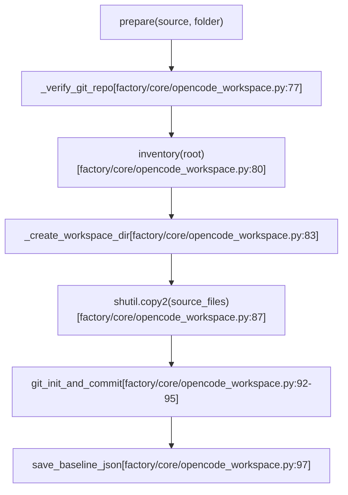
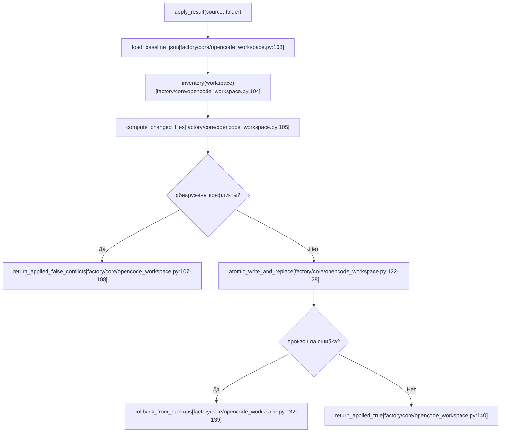
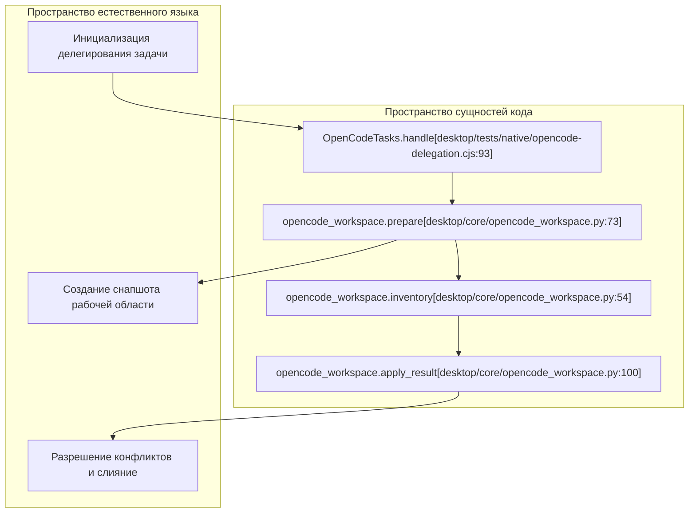

# Снапшоты рабочей области и проверка переноса

Релевантные исходные файлы

Следующие файлы использовались как контекст при генерации этой страницы вики:

- [desktop/backend.py](desktop/backend.py)
- [desktop/main.cjs](desktop/main.cjs)
- [desktop/opencode-sandbox.py](desktop/opencode-sandbox.py)
- [desktop/opencode-workspace.cjs](desktop/opencode-workspace.cjs)
- [desktop/opencode_profiles.py](desktop/opencode_profiles.py)
- [desktop/tests/native/first-run.cjs](desktop/tests/native/first-run.cjs)
- [desktop/tests/native/opencode-delegation.cjs](desktop/tests/native/opencode-delegation.cjs)
- [factory/core/mobile_bridge/files.py](factory/core/mobile_bridge/files.py)
- [factory/core/opencode_workspace.py](factory/core/opencode_workspace.py)
- [tests/test_opencode_profiles.py](tests/test_opencode_profiles.py)

## Назначение и область охвата
Подсистема снапшотов рабочей области и проверки переноса (`factory/core/opencode_workspace.py`) отвечает за создание чистых, изолированных базовых состояний файловой системы для фоновых задач кодирования, делегируемых сессиям OpenCode в песочнице [factory/core/opencode_workspace.py:1](). Она даёт строгие гарантии безопасности: изолирует целевые репозитории исходников, фиксирует опись файлов через Git и хеш-суммы, блокирует атаки через symlink-переходы, фильтрует чувствительные файлы, обнаруживает изменения исходников во время выполнения задачи и безопасно применяет или отклоняет изменения по результатам проверки конфликтов.

---

## 1. Подготовка снапшота (`prepare`)

При запуске делегированной задачи OpenCode система вызывает `prepare(source, folder)`, чтобы создать независимую копию рабочей области [factory/core/opencode_workspace.py:73-98]().

### Порядок подготовки
1. **Валидация**: разрешает исходный путь, проверяет, что это абсолютный каталог, убеждается, что это не домашний каталог и не корень, и проверяет наличие Git-репозитория (`rev-parse --show-toplevel`) [factory/core/opencode_workspace.py:74-77](). Сабмодули явно отклоняются (совпадение `160000` в `ls-files --stage`) [factory/core/opencode_workspace.py:78-79]().
2. **Индексация описи**: сканирует все кешированные и неотслеживаемые файлы через `inventory(root)`, пропуская игнорируемые файлы и чувствительные пути [factory/core/opencode_workspace.py:54-70, 80]().
3. **Изоляция рабочей области**: создаёт защищённый рабочий подкаталог (`folder/workspace`) с правами `0o700` [factory/core/opencode_workspace.py:81-83]() и копирует обычные неигнорируемые файлы через `shutil.copy2` с `follow_symlinks=False` [factory/core/opencode_workspace.py:84-87]().
4. **Базовая история Git**: инициализирует чистый Git-репозиторий внутри рабочей области, коммитит все staged-файлы с фиксированным автором (`Igorek`) и архивирует метаданные `.git` в `folder/baseline.git` рядом с JSON-описью (`folder/baseline.json`) [factory/core/opencode_workspace.py:92-97]().

*Источники: [factory/core/opencode_workspace.py:73-98]()*

---

## 2. Отслеживание описи и гарантии изоляции исходников

Изоляция исходников опирается на строгие функции валидации файлов, определённые в `opencode_workspace.py`, чтобы предотвратить несанкционированный доступ к файлам и обход каталогов:

- **`private(name)`**: блокирует чувствительные пути и учётные данные, такие как `.git`, `.aws`, `.ssh`, `.gnupg`, `.codex`, `.claude`, `.igorek-agent-factory`, `Archive`, `docs/local` и файлы окружения (`.env`, `.env.*`, кроме `.example`) [factory/core/opencode_workspace.py:29-33]().
- **`entry(root, name)`**: проверяет, что целевые пути не содержат переходов к родительским каталогам (`..`), не являются symlink, ведущими за пределы `root`, являются обычными файлами (`stat.S_ISREG`) и не превышают ограничения по размеру (`MAX_BYTES = 512MB`) [factory/core/opencode_workspace.py:36-51](). Возвращает объект с хеш-суммами SHA-256, правами доступа к файлу (`mode`) и размером [factory/core/opencode_workspace.py:51]().
- **`inventory(root, control)`**: строит полную карту относительных путей в хеши и метаданные файлов для кешированных и неотслеживаемых файлов, соблюдая общие лимиты (`MAX_FILES = 20000`, `MAX_BYTES = 512MB`) [factory/core/opencode_workspace.py:54-70]().

---

## 3. Обнаружение конфликтов и применение результата (`apply_result`)

По завершении сессии OpenCode `apply_result(source, folder)` оценивает, можно ли безопасно влить изменения, сделанные внутри изолированной рабочей области, обратно в живой исходник проекта [factory/core/opencode_workspace.py:100-140]().

### Проверка конфликтов и порядок применения
1. **Сравнение с базой**: читает заархивированный `baseline.json` и снимает опись текущего состояния рабочей области относительно `baseline.git`, чтобы определить множество изменённых файлов (`changed`) [factory/core/opencode_workspace.py:103-104]().
2. **Анализ конфликтов**: находит конфликты, проверяя, изменился ли какой-либо из изменённых файлов в живом исходнике (`root`) с момента создания базового снапшота (`entry(root, name) != baseline.get(name)`) [factory/core/opencode_workspace.py:106](). Если конфликты есть, применение прерывается и возвращается `{'applied': False, 'conflicts': conflicts, 'files': changed}` [factory/core/opencode_workspace.py:107-108]().
3. **Атомарная запись и откат**: если конфликтов нет, резервирует существующее содержимое файлов, атомарно записывает новое содержимое через временные файлы (`.igorek-...`), обновляет режимы файлов и подменяет живые цели [factory/core/opencode_workspace.py:110-130](). Если при применении происходит ошибка, все изменения полностью откатываются по словарю резервных копий [factory/core/opencode_workspace.py:131-139]().

*Источники: [factory/core/opencode_workspace.py:100-140]()*

---

## 4. Интеграция с подсистемой делегирования и тестами

Механика снапшотов рабочей области и переноса вызывается контроллером задач (`OpenCodeTasks`) и проверяется нативными интеграционными тест-фикстурами (`desktop/tests/native/opencode-delegation.cjs`) [desktop/tests/native/opencode-delegation.cjs:7-28]().

Тестовый харнесс порождает Python-подпроцессы для выполнения `prepare` и `apply_result`, гарантируя, что изменения файлов в окружениях раннера в песочнице соблюдают ограничения безопасности и точно ловят параллельные правки исходников [desktop/tests/native/opencode-delegation.cjs:24-28]().

*Источники: [desktop/tests/native/opencode-delegation.cjs:7-28](), [factory/core/opencode_workspace.py:54-100]()*
