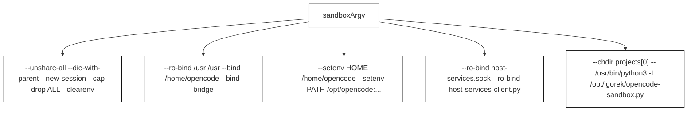
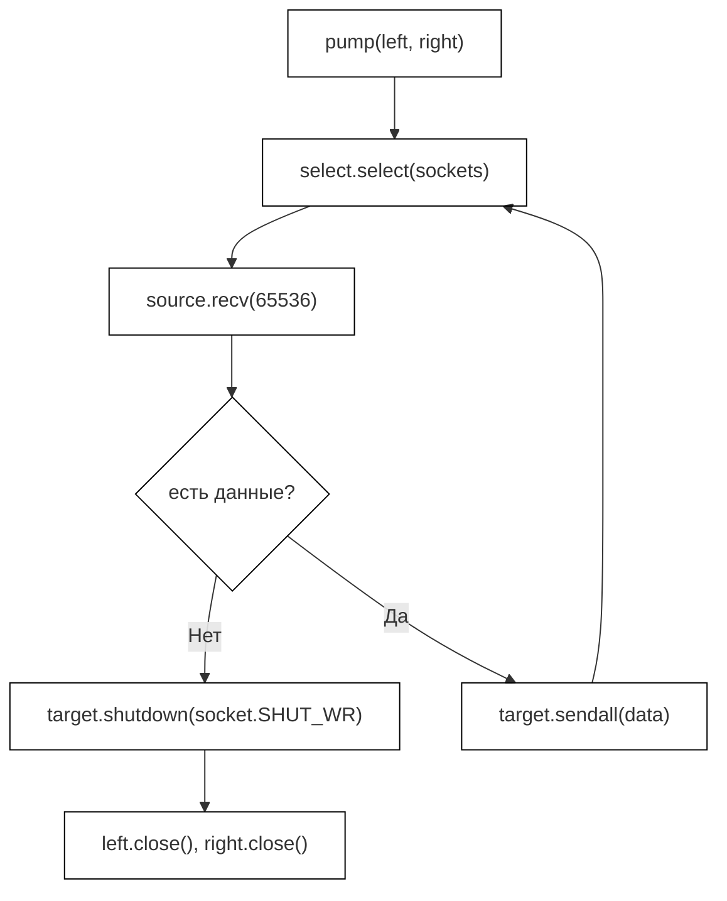
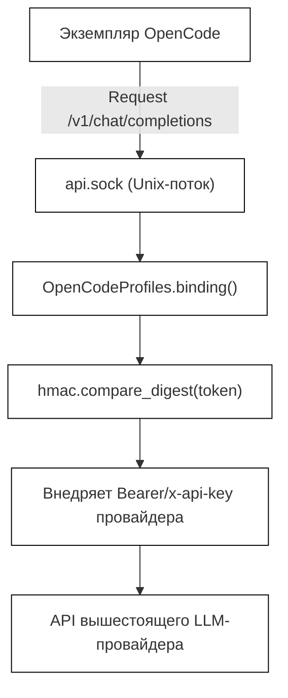

# Профили песочницы и хост-сервисы

Релевантные исходные файлы

Следующие файлы использовались как контекст при генерации этой страницы вики:

- [desktop/backend.py](desktop/backend.py)
- [desktop/opencode-sandbox.py](desktop/opencode-sandbox.py)
- [desktop/opencode-service.cjs](desktop/opencode-service.cjs)
- [desktop/opencode-tasks.cjs](desktop/opencode-tasks.cjs)
- [desktop/opencode-workspace.cjs](desktop/opencode-workspace.cjs)
- [desktop/opencode_profiles.py](desktop/opencode_profiles.py)
- [tests/test_opencode_profiles.py](tests/test_opencode_profiles.py)

## Назначение и область охвата

Эта страница описывает подсистему изоляции, параметры контейнеризации, проксирование профилей и архитектуру хост-сервисов, которые используются при делегировании фоновых задач кодирования сессиям OpenCode в песочнице. Она разбирает построение аргументов командной строки Bubblewrap (`bwrap`), контейнерный скрипт точки входа (`opencode-sandbox.py`), изоляцию учётных данных через `opencode_profiles.py`, мосты проксирования потоков и интеграцию хост-сервисов Model Context Protocol (MCP).

---

## 1. Конфигурация песочницы Bubblewrap (`sandboxArgv`)

Оркестрирующий слой на стороне хоста готовит изолированный Linux-контейнер с помощью Bubblewrap. Функция `sandboxArgv` формирует строгий вектор аргументов изоляции (`argv`), который снимает capabilities хоста, выборочно монтирует файловые системы, сбрасывает переменные окружения и настраивает внутренние пути песочницы [desktop/opencode-service.cjs:26-46]().

*Рисунок 5.3.1: связь с сущностями кода при генерации вектора аргументов `sandboxArgv`.*

Источники: `desktop/opencode-service.cjs`

---

## 2. Выполнение в гостевой среде и прокачка потоков (`opencode-sandbox.py`)

Внутри контейнера Bubblewrap `opencode-sandbox.py` выступает низкоуровневым супервизором и мостом потоков [desktop/opencode-sandbox.py:1-49](). Он запускает процедуры перенаправления потоков (`pump`) между Unix-сокетами и управляет клиентскими запросами [desktop/opencode-sandbox.py:13-30]().

*Рисунок 5.3.2: логика цикла прокачки потоков внутри `opencode-sandbox.py`.*

Источники: `desktop/opencode-sandbox.py`

---

## 3. Безопасность профилей и проксирование токенов (`opencode_profiles.py`)

Чтобы агенты кодирования в песочнице не раскрывали реальные API-ключи и не подменяли конечные точки моделей, `OpenCodeProfiles` перехватывает запросы конфигурации провайдеров [desktop/opencode_profiles.py:25-113](). Он публикует проверенные профили через Unix domain socket и проксирует запросы, подставляя заголовки аутентификации на стороне хоста [desktop/opencode_profiles.py:128-141]().

*Рисунок 5.3.3: поток проверки токенов прокси профилей и изоляции учётных данных.*

Источники: `desktop/opencode_profiles.py`, `tests/test_opencode_profiles.py`

---

## 4. Сокеты моста и межпроцессное взаимодействие

Обмен между хостовым окружением, десктопным харнессом и гостем в песочнице идёт через изолированные UNIX domain sockets, отображённые в `/run/igorek` внутри контейнера [desktop/opencode-service.cjs:26-34]().

- **`api.sock`**: основной шлюз для запросов к управляющему API сервера OpenCode [desktop/opencode-tasks.cjs:10-28]().
- **`host-services.sock`**: сокет, дающий контролируемое выполнение хостовых операций через MCP-клиент [desktop/opencode-service.cjs:37-41]().
- **`profiles.sock`**: сокет, открывающий песочнице доступ к ограниченному набору LLM-профилей [desktop/opencode-service.cjs:43]().

Источники: `desktop/opencode-service.cjs`, `desktop/opencode-tasks.cjs`

---

## 5. Токены хост-сервисов и интеграция MCP

Когда хост-сервисы включены в `sandboxArgv`, локальный файл токена монтируется по пути `/run/igorek-host-services-token` рядом с `host-services-client.py` [desktop/opencode-service.cjs:37-41](). Переменная окружения `OPENCODE_CONFIG_CONTENT` настраивает сервер Model Context Protocol (MCP) внутри OpenCode так, чтобы инструменты шли через хостовый мост [desktop/opencode-service.cjs:41]().

Источники: `desktop/opencode-service.cjs`, `desktop/backend.py`
