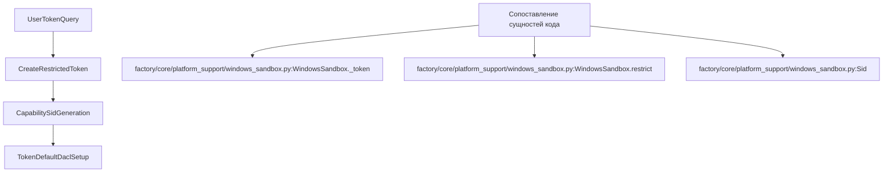
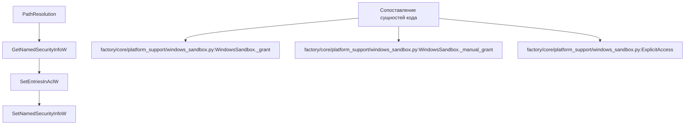
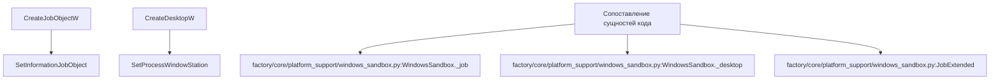
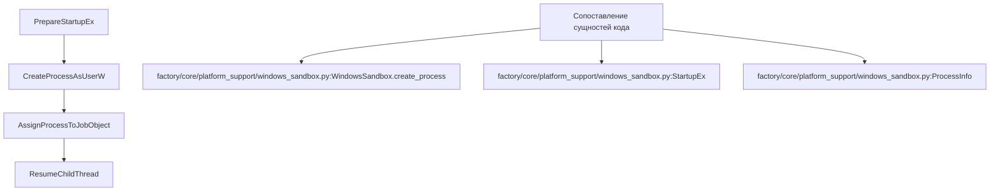

# Внутреннее устройство WindowsSandbox

Релевантные исходные файлы

Следующие файлы использовались как контекст при генерации этой страницы вики:

- [desktop/native/windows-pipes.cpp](desktop/native/windows-pipes.cpp)
- [factory/core/platform_support/windows_sandbox.py](factory/core/platform_support/windows_sandbox.py)
- [tests/test_platform_support.py](tests/test_platform_support.py)

## Назначение и область охвата

Подсистема песочницы Windows обеспечивает строгую изоляцию дочерних процессов, работающих на хостах Windows в архитектуре Igorek-Harness. Она проводит принцип минимальных привилегий, комбинируя примитивы безопасности Windows NT: ограниченные токены пользователя, уникальные capability SID, настраиваемые Discretionary Access Control Lists (DACL), метки целостности, изолированные window station/рабочие столы и объекты заданий с жёсткими лимитами ресурсов.

Эта страница разбирает реализацию `WindowsSandbox` и её жизненный цикл безопасности, определённые в `factory/core/platform_support/windows_sandbox.py` и покрытые тестами в `tests/test_platform_support.py`.

Источники: `factory/core/platform_support/windows_sandbox.py`, `tests/test_platform_support.py`

---

## Ограниченные токены и capability SID

Чтобы задача агента в песочнице не могла поднять привилегии или взаимодействовать с чувствительными компонентами системы, `WindowsSandbox` создаёт ограниченный токен через `CreateRestrictedToken`.

При инициализации (`factory/core/platform_support/windows_sandbox.py`) генерируется уникальный capability SID вида `S-1-5-21-...` [factory/core/platform_support/windows_sandbox.py:83](). Этот SID присваивается токену, чтобы доступ к ресурсам ограничивался только явно выданными каталогами рабочей области и одноразовыми корнями.

*Диаграмма: от естественного языка к пространству сущностей кода для ограничения токена.*

Источники: `factory/core/platform_support/windows_sandbox.py`, `tests/test_platform_support.py`

---

## Гранты DACL и метки целостности

Доступ к файлам и каталогам контролируется явными изменениями DACL. Песочница управляет разрешениями, переводя пути в дескрипторы безопасности через функции Windows API вроде `SetNamedSecurityInfoW` и `SetEntriesInAclW` [factory/core/platform_support/windows_sandbox.py:120]().

- **Корни для чтения / записи**: пути рабочей области и назначенные входные каталоги получают доступ на чтение или запись относительно корня экземпляра песочницы [factory/core/platform_support/windows_sandbox.py:87]().
- **Ручные проекты**: явные ручные гранты на проекты можно выдать и затем отозвать, чтобы временный доступ между рабочими областями не оставался активным [factory/core/platform_support/windows_sandbox.py:92]().
- **Метки целостности**: уровни целостности ограничивают запись из процессов с более низкой целостностью в цели с более высокой целостностью, предотвращая порчу данных.

*Диаграмма: порядок изменения DACL и сопоставление с кодом.*

Источники: `factory/core/platform_support/windows_sandbox.py`

---

## Изолированные рабочие столы и объекты заданий

Процессы в песочнице изолированы от основного рабочего стола пользователя и привязаны к управляющим ресурсами объектам заданий, чтобы ограничить процессорное время, потребление памяти и рост дерева процессов.

- **Изолированные рабочие столы**: приватный рабочий стол создаётся через desktop API, чтобы изолировать операции с буфером обмена и оконные сообщения от активной сессии пользователя [factory/core/platform_support/windows_sandbox.py:95]().
- **Объекты заданий**: объекты заданий используют структуры вроде `JobBasic` и `JobExtended`, чтобы ограничивать рабочие наборы и применять политики завершения процессов при закрытии хендла песочницы [factory/core/platform_support/windows_sandbox.py:36]().

*Диаграмма: жизненный цикл объекта задания и изоляции рабочего стола.*

Источники: `factory/core/platform_support/windows_sandbox.py`

---

## Жизненный цикл запуска процесса

Финальная фаза развёртывания песочницы — запуск целевого исполняемого файла под настроенным контекстом безопасности. `WindowsSandbox` использует `CreateProcessAsUserW` вместе с расширенной стартовой информацией (`StartupEx`), чтобы применить ограниченный токен, привязать новый процесс к объекту задания и направить его через изолированный рабочий стол [factory/core/platform_support/windows_sandbox.py:131]().

*Диаграмма: жизненный цикл запуска процесса и сопоставление с API.*

Источники: `factory/core/platform_support/windows_sandbox.py`, `tests/test_platform_support.py`
