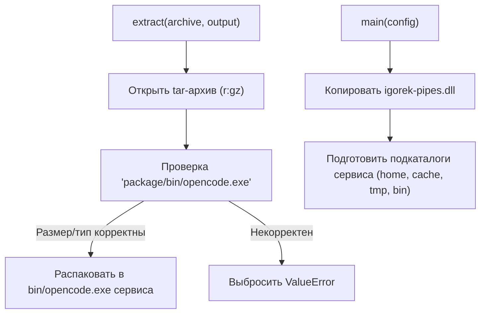
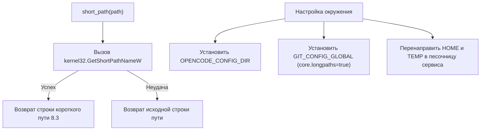
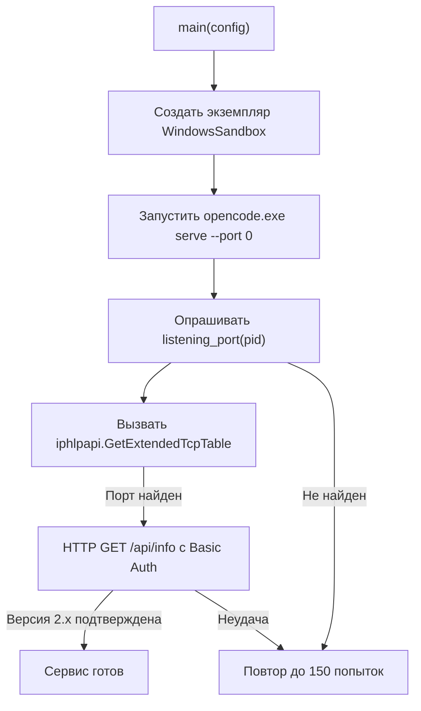

# Хост-раннер OpenCode для Windows

Используемые исходные файлы

Для генерации этой страницы вики использовались следующие файлы:

- [desktop/opencode-windows.py](desktop/opencode-windows.py)
- [desktop/packaging/build-windows-runtime.py](desktop/packaging/build-windows-runtime.py)

## Назначение и область применения

Модуль `desktop/opencode-windows.py` выступает хост-раннером для запуска и управления нативным сервисом OpenCode внутри песочницы на Windows-платформах. Он отвечает за безопасную распаковку архивов с бинарниками бэкенда, сокращение путей для легаси-совместимых переменных окружения, изоляцию пользовательского окружения, создание процесса песочницы через ограниченные токены и job-объекты, а также за обнаружение TCP-портов с помощью низкоуровневых IP Helper API.

Sources: `[desktop/opencode-windows.py:1-19]()`

---

## Распаковка архивов и подготовка бинарников

Раннер начинает работу с распаковки необходимых пакетов и бинарников. Функция `extract(archive, output)` выполняет распаковку gzipped tar-архивов, выбирая конкретно `package/bin/opencode.exe` [desktop/opencode-windows.py:20-29].

Ключевые проверки безопасности при распаковке:
- Ограничение режима создания выходного каталога (`0o700`) [desktop/opencode-windows.py:22].
- Проверка, что элемент архива является обычным файлом и его размер ограничен диапазоном от 1 байта до 300 МБ [desktop/opencode-windows.py:25].
- Копирование бинарника сервиса и нативного pipe-адаптера (`igorek-pipes.dll`) в каталог `bin/` сервиса [desktop/opencode-windows.py:75-80].

Sources: `[desktop/opencode-windows.py:20-29]`, `[desktop/opencode-windows.py:73-80]()`

---

## Изоляция окружения и работа с короткими путями

В Windows-окружениях легаси-инструментарий часто упирается в ограничения на длину путей и специальные символы. Для смягчения этой проблемы `desktop/opencode-windows.py` реализует две ключевые стратегии управления окружением:

1. **Разрешение коротких путей (`short_path`)**: использует `kernel32.GetShortPathNameW` для получения 8.3-совместимых коротких путей для каталогов вроде `XDG_DATA_HOME` [desktop/opencode-windows.py:49-57, 97].
2. **Изоляция окружения**: формирует изолированный словарь с минимально необходимыми корневыми ключами Windows (`SystemRoot`, `WINDIR`, `COMSPEC`), перенаправляет переменные профиля пользователя и данных приложений (`HOME`, `USERPROFILE`, `APPDATA`, `LOCALAPPDATA`, `TEMP`, `TMP`) в каталоги home/tmp сервиса и настраивает глобальные опции Git [desktop/opencode-windows.py:90-102].

Sources: `[desktop/opencode-windows.py:49-58]`, `[desktop/opencode-windows.py:88-102]()`

---

## Запуск песочницы и обнаружение TCP-порта

После настройки окружения и каталогов раннер создаёт экземпляр `WindowsSandbox` [desktop/opencode-windows.py:119] и запускает бинарник сервиса OpenCode с динамическим назначением loopback-порта (`--port 0`) [desktop/opencode-windows.py:122].

Поскольку дочерний процесс привязывается к эфемерному порту, `desktop/opencode-windows.py` использует `listening_port(pid)` [desktop/opencode-windows.py:31-46], чтобы опрашивать активные TCP-слушатели через `iphlpapi.GetExtendedTcpTable`, сопоставляя идентификатор процесса и loopback-адрес (`127.0.0.1`) [desktop/opencode-windows.py:44].

Sources: `[desktop/opencode-windows.py:31-46]`, `[desktop/opencode-windows.py:119-141]()`
