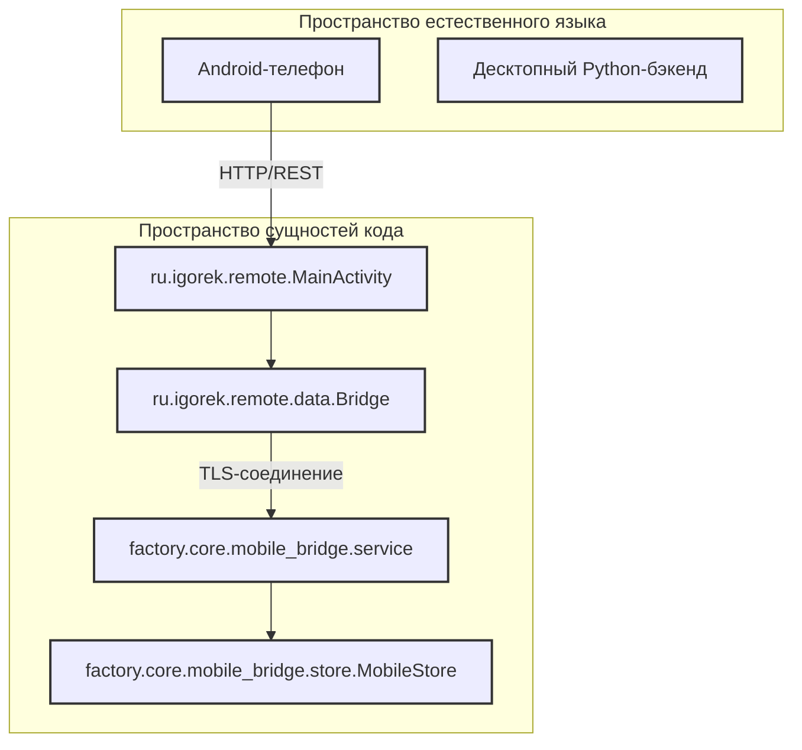
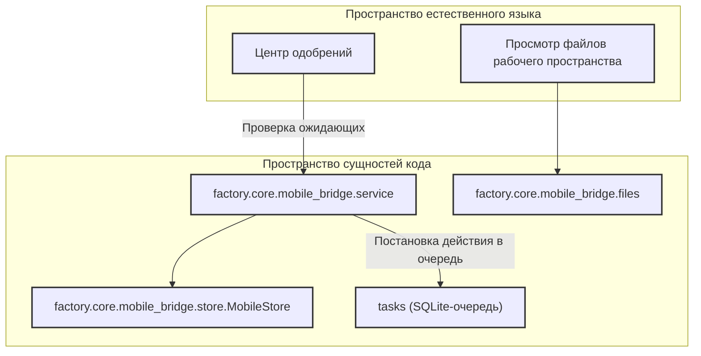

# Мобильный клиент: Android и мост

Используемые исходные файлы

Для генерации этой страницы вики использовались следующие файлы:

- [android/app/build.gradle.kts](android/app/build.gradle.kts)
- [android/app/src/main/assets/release-notes.json](android/app/src/main/assets/release-notes.json)
- [android/app/src/main/java/ru/igorek/remote/ui/SessionBrowserPanel.kt](android/app/src/main/java/ru/igorek/remote/ui/SessionBrowserPanel.kt)
- [android/build.gradle.kts](android/build.gradle.kts)
- [android/gradle/libs.versions.toml](android/gradle/libs.versions.toml)
- [factory/core/mobile_bridge/service.py](factory/core/mobile_bridge/service.py)

Эта страница даёт архитектурный обзор экосистемы мобильного удалённого клиента Igorek-Harness, состоящей из нативного Android-приложения (`android/`) и сопутствующей Python-подсистемы `mobile_bridge` (`factory/core/mobile_bridge/`) [factory/core/mobile_bridge/service.py:1-7](). Вместе эти компоненты позволяют пользователю безопасно взаимодействовать с десктопными сессиями агентов, одобрять высокорисковые действия, просматривать удалённые деревья файлов и управлять превью браузера с Android-устройства.

Как родительская страница, этот документ описывает ключевые обязанности клиента и бэкенда моста. Детали реализации см. в разделах [Структура и сборка Android-приложения](#7.1) и [Бэкенд мобильного моста](#7.2).

*Рисунок 7.1: Сопоставление верхнего уровня между мобильными операциями пользователя и сущностями кода Android-клиента и Python-моста.*

Sources: `android/app/build.gradle.kts:40-50`, `factory/core/mobile_bridge/service.py:1-105`

---

## 7.1. Структура и сборка Android-приложения

Android-клиент — это нативное Jetpack Compose-приложение на Kotlin, ориентированное на современные рантаймы Android (`minSdk 26`, `compileSdk 37`) [android/app/build.gradle.kts:43-46]. Кодовая база организована вокруг модульных UI-панелей (например, `SessionBrowserPanel.kt`), фоновых сервисов моста и интеграции голосовых звонков. Сетевое взаимодействие построено на OkHttp с certificate pinning и собственным обработчиком TLS, а безопасное хранение учётных данных использует EncryptedSharedPreferences.

Система сборки использует Gradle с Kotlin DSL (`build.gradle.kts`), управляя зависимостями AndroidX, компонентами Compose Material 3 и Kotlin-сериализацией через каталоги версий (`gradle/libs.versions.toml`) [android/gradle/libs.versions.toml:1-34]. Release-сборки требуют строгой валидации примечаний к релизу (`verifyReleaseNotes`) и криптографических конфигураций подписи (`verifyReleaseSigning`), что гарантирует безопасные артефакты дистрибутива [android/app/build.gradle.kts:87-127].

Подробности об активити, Compose-панелях, конфигурациях Gradle и подписи релиза см. в разделе [Структура и сборка Android-приложения](#7.1).

Sources: `android/build.gradle.kts:1-6`, `android/app/build.gradle.kts:37-146`, `android/app/src/main/java/ru/igorek/remote/ui/SessionBrowserPanel.kt:72-120`, `android/gradle/libs.versions.toml:1-34`

---

## 7.2. Бэкенд мобильного моста

Бэкенд мобильного моста (`factory/core/mobile_bridge/`) встроен непосредственно в существующий рантайм Igorek, а не работает как отдельный исполнитель [factory/core/mobile_bridge/service.py:1-7]. Он маршрутизирует сообщения через общую очередь `tasks`, дописывает историю в те же журналы `chat_sessions/*.jsonl`, которыми пользуются TUI- и Telegram-клиенты, и разделяет хранилище одобрений и пользовательского ввода [factory/core/mobile_bridge/service.py:1-7].

Ключевые модули бэкенда моста отвечают за безопасные файловые операции (`files.py`), загрузку сессий (`uploads.py`), персистентные хранилища учётных данных и данных сопряжения (`store.py`) и фильтрацию высокорисковых инструментов (`HIGH_RISK_TOOLS`) [factory/core/mobile_bridge/service.py:105-122]. Мост предоставляет конечные точки для проверки сопряжения, инспекции файлов рабочего пространства и процессов удалённого одобрения, сохраняя гарантии изоляции с десктопным ядром.

*Рисунок 7.2: Компоненты бэкенда моста, обрабатывающие мобильные запросы и взаимодействующие с общим хранилищем.*

Sources: `factory/core/mobile_bridge/service.py:1-140`

Подробности о сервере моста, SQLite-хранилищах, маршрутизаторах источников, протоколах безопасного доступа к файлам и покрытии тестами см. в разделе [Бэкенд мобильного моста](#7.2).
