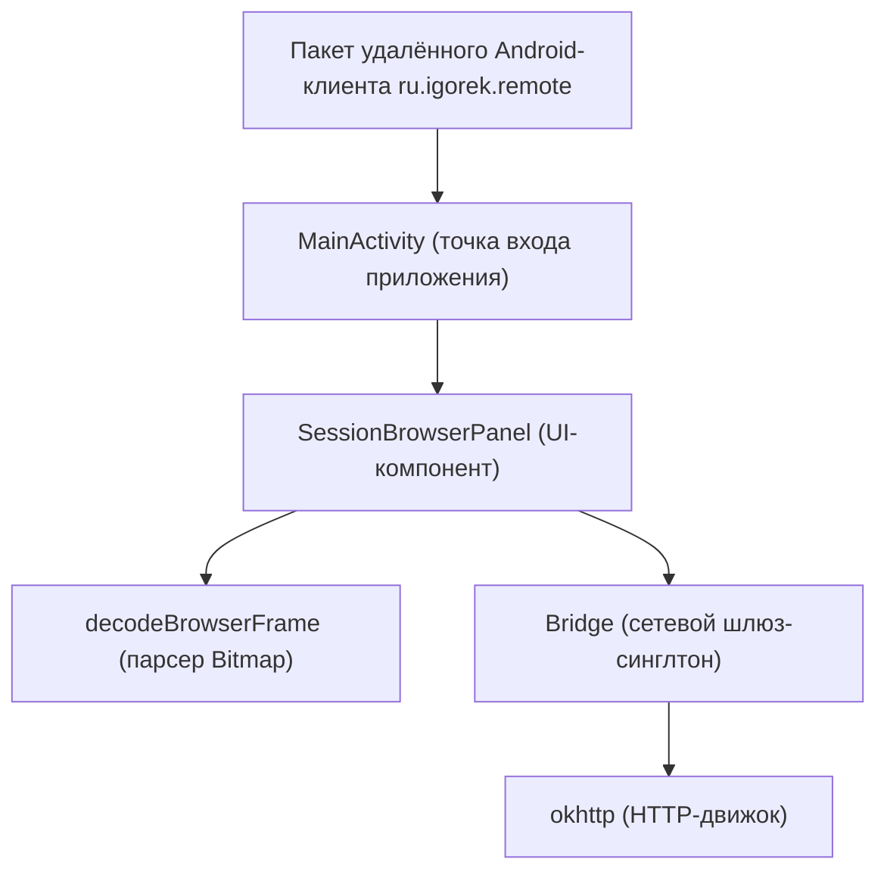
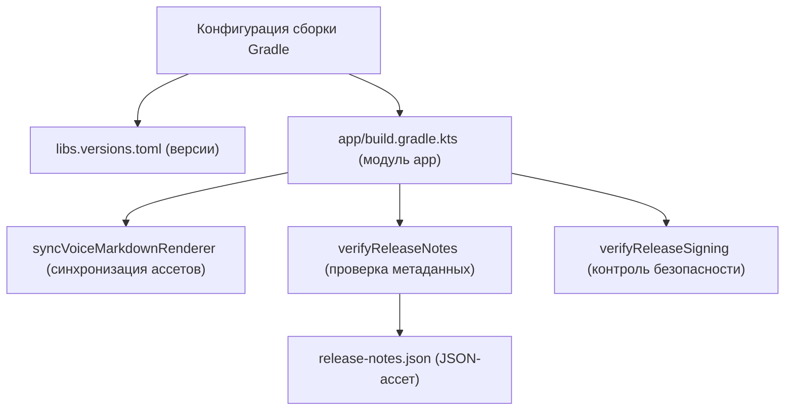

# Структура и сборка Android-приложения

Используемые исходные файлы

Для генерации этой страницы вики использовались следующие файлы:

- [android/app/build.gradle.kts](android/app/build.gradle.kts)
- [android/app/src/main/assets/release-notes.json](android/app/src/main/assets/release-notes.json)
- [android/app/src/main/java/ru/igorek/remote/ui/SessionBrowserPanel.kt](android/app/src/main/java/ru/igorek/remote/ui/SessionBrowserPanel.kt)
- [android/build.gradle.kts](android/build.gradle.kts)
- [android/gradle/libs.versions.toml](android/gradle/libs.versions.toml)
- [android/gradle/wrapper/gradle-wrapper.jar](android/gradle/wrapper/gradle-wrapper.jar)
- [android/gradle/wrapper/gradle-wrapper.properties](android/gradle/wrapper/gradle-wrapper.properties)
- [android/gradlew](android/gradlew)
- [android/gradlew.bat](android/gradlew.bat)
- [desktop/about.html](desktop/about.html)

## Назначение и область применения

Модуль Android-клиента (`ru.igorek.remote`) предоставляет удалённый интерфейс на Kotlin и Jetpack Compose к десктопу и ядру харнесса Igorek. Он отвечает за сетевое взаимодействие через `Bridge`, безопасное локальное хранилище через `androidx.security:security-crypto`, отрисовку реактивных UI-панелей вроде `SessionBrowserPanel`, а также за строгие процессы сборки на Gradle, синхронизацию ассетов и политики криптографической подписи.

Sources: `[android/app/build.gradle.kts:40-50](), [android/app/src/main/java/ru/igorek/remote/ui/SessionBrowserPanel.kt:60-75]()`

---

## Структура Kotlin-приложения и UI-панели

Android-приложение живёт в пространстве имён пакета `ru.igorek.remote`, ориентируясь на `compileSdk` 37 и `minSdk` 26 (`[android/app/build.gradle.kts:40-45]()`). Пользовательский интерфейс целиком построен на Jetpack Compose и компонентах Material 3.

### Панель браузера сессий

Компонент `SessionBrowserPanel` (`[android/app/src/main/java/ru/igorek/remote/ui/SessionBrowserPanel.kt:72-120]()`) управляет взаимодействием с превью браузера, декодируя кадры JPEG в кодировке base64 (`[android/app/src/main/java/ru/igorek/remote/ui/SessionBrowserPanel.kt:50-58]()`) и выполняя фоновый опрос с учётом жизненного цикла через `repeatOnLifecycle` (`[android/app/src/main/java/ru/igorek/remote/ui/SessionBrowserPanel.kt:92-118]()`).

Sources: `[android/app/src/main/java/ru/igorek/remote/ui/SessionBrowserPanel.kt:50-123]()`

---

## Конфигурация Gradle и каталоги версий зависимостей

Конфигурация сборки использует каталоги версий Gradle (`libs.versions.toml`) для централизованного управления версиями зависимостей всего Android-проекта (`[android/gradle/libs.versions.toml:1-33]()`).

### Таблица основных зависимостей

| Группа зависимостей и артефакт | Ссылка на версию | Роль в модуле app |
| :--- | :--- | :--- |
| `androidx.compose:compose-bom` | `2026.09.00` | Bill of Materials для Jetpack Compose |
| `com.squareup.okhttp3:okhttp` | `5.5.0` | HTTP-транспорт и SSE-клиент для Bridge |
| `org.jetbrains.kotlinx:kotlinx-serialization-json` | `1.11.0` | JSON-сериализация payload-ов моста |
| `androidx.security:security-crypto` | `1.1.0` | Шифрование SharedPrefs и ключей хранилища |
| `com.journeyapps:zxing-android-embedded` | `4.3.0` | Сканирование QR-кодов для сопряжения |

Sources: `[android/gradle/libs.versions.toml:1-33](), [android/app/build.gradle.kts:129-146]()`

Sources: `[android/gradle/libs.versions.toml:1-33](), [android/app/build.gradle.kts:1-146]()`

---

## Задачи сборки, синхронизация ассетов и проверка релиза

Скрипт сборки модуля app (`[android/app/build.gradle.kts:1-146]()`) определяет автоматические задачи для подготовки тестовых окружений, синхронизации статических ассетов из Python-бэкенда и валидации метаданных релиза.

### Пользовательские задачи Gradle

* **`generateTestTlsKey`**: генерирует самоподписанный keystore в формате PKCS12 (`loopback-test.p12`) для фикстур TLS unit- и instrumentation-тестов (`[android/app/build.gradle.kts:12-25]()`).
* **`syncVoiceMarkdownRenderer`**: копирует `factory/web_ui/static/render.js` и drawable-ресурсы с осьминогом в каталог генерируемых voice markdown-ассетов до начала сборки (`[android/app/build.gradle.kts:28-35]()`).
* **`verifyReleaseNotes`**: разбирает `src/main/assets/release-notes.json` (`[android/app/src/main/assets/release-notes.json:1-16]()`) и проверяет, что `versionName` и `versionCode` совпадают с `defaultConfig`, а также наличие двуязычных (`ru`/`en`) заметок перевода (`[android/app/build.gradle.kts:101-127]()`).

Sources: `[android/gradle/libs.versions.toml:1-33](), [android/app/build.gradle.kts:28-127](), [android/app/src/main/assets/release-notes.json:1-16]()`

---

## Gradle Wrapper и конвейер подписи

Проект включает стандартные wrapper-скрипты для POSIX (`[android/gradlew:1-50]()`) и Windows (`[android/gradlew.bat:1-30]()`) на базе Gradle версии `9.8.1` (`[android/gradle/wrapper/gradle-wrapper.properties:1-7]()`).

### Подпись релиза и защитные проверки

Release-сборки (`[android/app/build.gradle.kts:53-70]`) требуют определённых переменных окружения (`IGOREK_ANDROID_KEYSTORE`, `IGOREK_ANDROID_STORE_PASSWORD_FILE` и `IGOREK_ANDROID_KEY_ALIAS`). Пользовательская задача валидации `verifyReleaseSigning` перед упаковкой release-бинарников обеспечивает строгие ограничения безопасности:
1. Проверяет, что все необходимые переменные окружения заданы.
2. Утверждает, что входные пути подписи указывают на обычные файлы, а не на символические ссылки (`[android/app/build.gradle.kts:92-94]()`).
3. Гарантирует, что учётные данные keystore находятся *вне* дерева каталогов репозитория (`[android/app/build.gradle.kts:95]()`).

Sources: `[android/gradle/wrapper/gradle-wrapper.properties:1-7](), [android/gradlew:1-50](), [android/gradlew.bat:1-30](), [android/app/build.gradle.kts:53-99]()`
