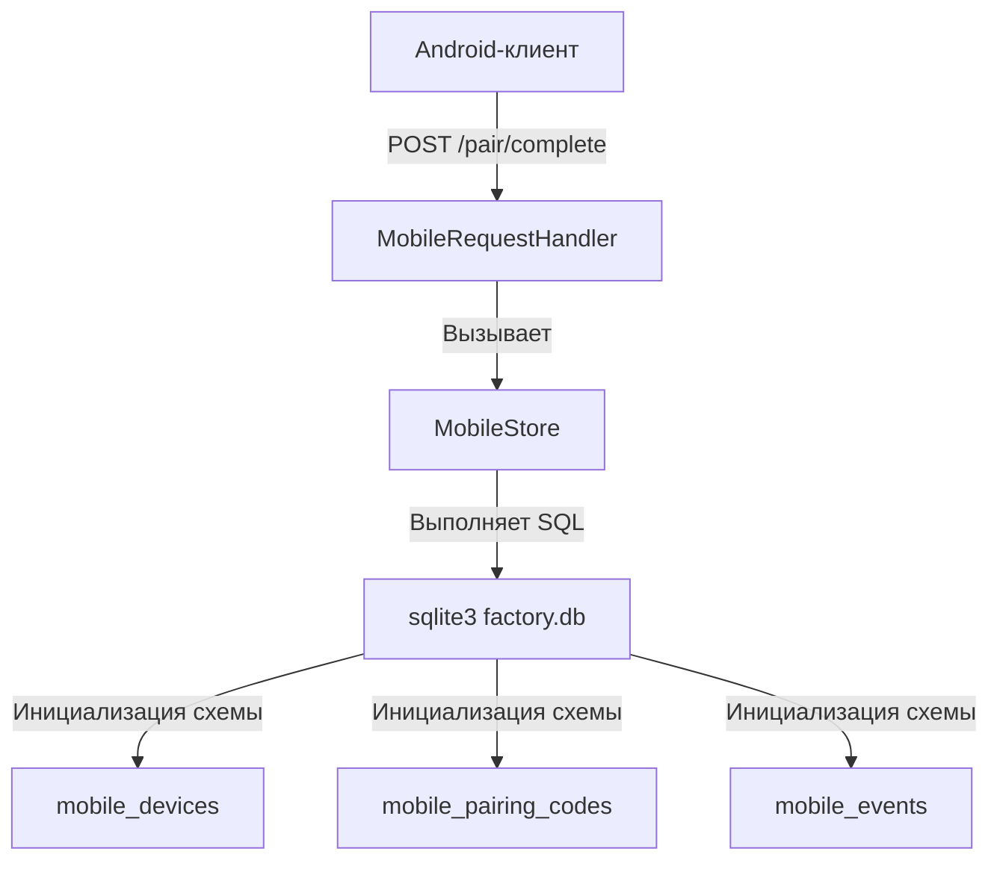
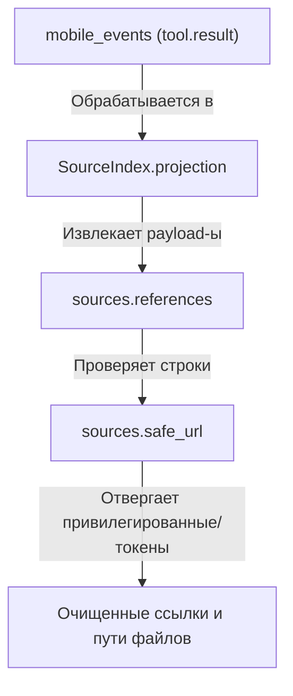

# Бэкенд мобильного моста

Используемые исходные файлы

Для генерации этой страницы вики использовались следующие файлы:

- [factory/core/mobile_bridge/service.py](factory/core/mobile_bridge/service.py)
- [factory/core/mobile_bridge/sources.py](factory/core/mobile_bridge/sources.py)
- [factory/core/mobile_bridge/store.py](factory/core/mobile_bridge/store.py)
- [tests/test_mobile_bridge_server.py](tests/test_mobile_bridge_server.py)
- [tests/test_session_sources.py](tests/test_session_sources.py)

Бэкенд мобильного моста (`mobile_bridge`) позволяет удалённым клиентам (например, сопутствующему Android-приложению) взаимодействовать напрямую с локальным рантаймом Igorek без создания отдельного исполнителя агента. Он ставит задачи в общий реестр задач, продолжает сессии в персистентных JSONL-журналах (`chat_sessions/*.jsonl`) и объединяет процессы одобрения и пользовательский ввод с каналами TUI и Telegram.

Sources: `[factory/core/mobile_bridge/service.py:1-7]()`

---

## 1. Хранилище состояния и архитектура сопряжения (`MobileStore`)

Персистентность устройств, одноразовые коды регистрации и монотонный поток событий управляются классом `MobileStore` в общей базе данных SQLite (`factory.db`).

Слой персистентности определяет четыре основные таблицы:
- `mobile_devices`: хранит метаданные, информацию о платформе и хешированные токены устройств (`token_hash`), защищённые application-level перцем (`_DEVICE_TOKEN_PEPPER`).
- `mobile_pairing_codes`: короткоживущие одноразовые коды (`code_hash`), защищённые `_PAIRING_CODE_PEPPER` со стандартным временем жизни (`_DEFAULT_PAIRING_TTL_S`).
- `mobile_events`: персистентный монотонный поток событий, индексируемый по `seq` для эффективной дельта-синхронизации переподключающихся клиентов.
- `mobile_requests`: отслеживает ключи идемпотентности и активные области выполнения.

Sources: `[factory/core/mobile_bridge/store.py:1-88]`, `[factory/core/mobile_bridge/store.py:145-193]()`

---

## 2. Сервис моста и постановка сообщений в очередь (`MobileService`)

`MobileService` координирует операции над активными сессиями агентов. Вместо запуска изолированных потоков выполнения он кладёт задачи в глобальную очередь `tasks`, которую разбирают локальные воркеры.

Ключевые атрибуты рантайма и политики, определённые в `service.py`:
- `ACTIVE_STATUSES`: охватывает состояния вроде `queued`, `processing`, `waiting_approval`, `cancelling` и `retry`.
- `FINAL_STATUSES`: терминальные состояния вроде `ok`, `fail`, `dead_letter`, `cancelled` и `timeout`.
- `HIGH_RISK_TOOLS`: обозначает инструменты (`write`, `edit`, `bash`), требующие явных повышенных разрешений или подтверждения через мобильное одобрение.
- Фильтрация чужих одобрений (`_FOREIGN_APPROVAL_FILTER_SQL`): исключает внешние платформенные одобрения (например, Telegram или привязки конкретных чатов) из мобильного центра одобрений, чтобы избежать дублирования решений.

Sources: `[factory/core/mobile_bridge/service.py:1-133]()`

---

## 3. Индексация источников и безопасный доступ к файлам (`SourceIndex`)

Класс `SourceIndex` кеширует и проецирует ссылки и пути изменённых файлов, извлечённые из персистентных журналов событий результатов инструментов.

Процесс извлечения ссылок разбирает payload-ы выходных данных инструментов, определяет корректные внешние URL через `safe_url()` и вырезает приватные query-параметры или ссылки с учётными данными (`_PRIVATE_QUERY`).

Sources: `[factory/core/mobile_bridge/sources.py:16-139]()`

---

## 4. Тестовые наборы и серверная интеграция

Функциональность мобильного моста проверяется обширными наборами серверных и unit-тестов, расположенными в `tests/test_mobile_bridge_server.py` и `tests/test_session_sources.py`.

- `ServerTestCase`: поднимает временную среду рантайма и создаёт фоновый экземпляр `MobileBridge`, работающий на эфемерном порту.
- `AuthFlowTest`: проверяет процессы сопряжения, отзыв устройств, ограничения sudo-запросов по обычному HTTP, валидацию токенов и сохранение состояния закрепления сессий.
- Тесты источников сессий гарантируют, что привилегированные URI (`file://`, `javascript:`, учётные данные в query-строках) строго отклоняются `safe_url()`, а незаписанные пути и файлы окружения исключаются из списков файлов сессии.

Sources: `[tests/test_mobile_bridge_server.py:1-163]`, `[tests/test_session_sources.py:1-121]()`
