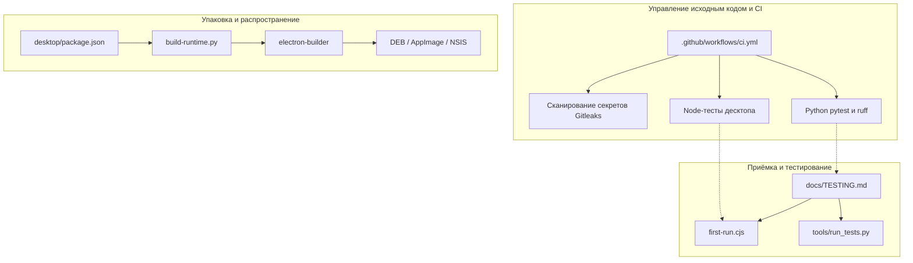
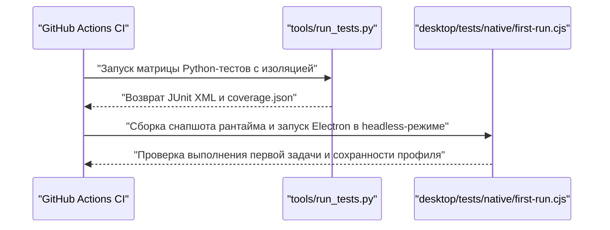

# Сборка, упаковка, CI и тестирование

Используемые исходные файлы

Для генерации этой страницы вики использовались следующие файлы:

- [.github/workflows/ci.yml](.github/workflows/ci.yml)
- [.gitignore](.gitignore)
- [.gitleaks.toml](.gitleaks.toml)
- [desktop/package-lock.json](desktop/package-lock.json)
- [desktop/package.json](desktop/package.json)
- [desktop/tests/helpers/private-permissions.cjs](desktop/tests/helpers/private-permissions.cjs)
- [docs/TESTING.md](docs/TESTING.md)

Эта страница даёт высокоуровневый обзор того, как проект Igorek-Harness собирается, упаковывается в готовые к развёртыванию десктопные и мобильные артефакты, проверяется автоматизированными workflow непрерывной интеграции и тестируется на всех своих многоязыковых слоях.

Как родительская страница, этот раздел знакомит с основными компонентами конвейера сборки и валидации. Подробные технические сведения о конкретных скриптах, конфигурационных файлах и механике выполнения смотрите на дочерних страницах:
- [Упаковка и распространение десктопного приложения](#8.1)
- [CI-workflow и проверки публикации](#8.2)
- [Наборы тестов и нативные приёмочные прогоны](#8.3)

*Источники: [desktop/package.json:1-28](), [.github/workflows/ci.yml:1-38](), [docs/TESTING.md:1-38]()*

---

## 8.1 Упаковка и распространение десктопного приложения

Десктопное приложение упаковывает оболочку Electron (`desktop/`) вместе с собранным бандлом рантайма Python. Скрипты сборки обрабатывают изоляцию зависимостей, бандлинг исходников и генерацию артефактов для платформ Linux и Windows.

Процесс упаковки использует скрипты, определённые в `desktop/package.json` [desktop/package.json:5-14](), для вызова Python-утилит бандлинга, таких как `packaging/build-runtime.py` и `packaging/build-windows-runtime.py`. Эти скрипты создают самодостаточные окружения Python, внедряют необходимый код приложения и конфигурируют `electron-builder` для производства установщиков и переносимых бинарников (например, пакетов DEB, AppImage и NSIS). Установщики политик песочницы (`install-sandbox-policy.sh`) гарантируют корректную настройку непривилегированных пользовательских namespace и профилей AppArmor на целевых Linux-хостах.

Подробные сведения о параметрах конфигурации, подготовке бандлов и артефактах для конкретных платформ см. в [Упаковка и распространение десктопного приложения](#8.1).

*Источники: [desktop/package.json:1-28](), [docs/TESTING.md:108-118]()*

---

## 8.2 CI-workflow и проверки публикации

Непрерывная интеграция и ворота качества оркестрируются через workflow GitHub Actions в `.github/workflows/ci.yml` [.github/workflows/ci.yml:1-38](). Конвейер CI требует строгих стандартов безопасности, стиля кода и покрытия тестами до того, как код будет влит или выпущен.

Ключевые задачи валидации:
- **Обнаружение секретов**: сканирование текущего дерева и полной истории git с помощью `gitleaks` по правилам `.gitleaks.toml` [.github/workflows/ci.yml:17-38]().
- **Матрица нескольких версий Python**: запуск проверок `ruff` и выполнение обширных наборов тестов на поддерживаемых версиях Python (`3.13`, `3.14`) с зафиксированными зависимостями (`uv sync --locked --dev`) [.github/workflows/ci.yml:38-86]().
- **Контракты десктопа**: валидация наборов Node-тестов на раннерах Linux и Windows [.github/workflows/ci.yml:87-106]().
- **Нативная приёмка**: сборка реальных офлайн-снапшотов и выполнение оконных сценариев Electron под `xvfb-run` [.github/workflows/ci.yml:107-157]().

Подробное описание определений action, правил dependabot и инструментов проверки контрактов публикации см. в [CI-workflow и проверки публикации](#8.2).

*Источники: [.github/workflows/ci.yml:1-162](), [.gitleaks.toml:1-25]()*

---

## 8.3 Наборы тестов и нативные приёмочные прогоны

Верификация в Igorek-Harness охватывает несколько различных тестовых раннеров и слоёв проверки; результаты документируются в структурированных отчётах покрытия и журналах релизов, как описано в `docs/TESTING.md` [docs/TESTING.md:1-38]().

Тестовая экосистема включает:
- **Модульные и интеграционные тесты Python**: обнаруживаются и запускаются через `tools/run_tests.py`; применяются дедлайны на каждый тест, изолированные временные данные Vault и отслеживание покрытия по ветвям [docs/TESTING.md:17-27]().
- **Node-тесты десктопа**: проверки контрактов компонентов и транспорта, выполняемые через `npm test` внутри `desktop/tests/` [docs/TESTING.md:28-32]().
- **Нативные приёмочные скрипты**: автоматизированные сценарии Electron (`desktop/tests/native/first-run.cjs`), проверяющие реальный рендеринг окна, делегирование первой задачи и сохранение состояния после перезапуска бэкенда [docs/TESTING.md:29-32]().
- **Вспомогательные утилиты**: специализированные скрипты проверок вроде `desktop/tests/helpers/private-permissions.cjs`, гарантирующие строгие права на файлы и списки контроля доступа (ACL) для чувствительных фикстур Vault [desktop/tests/helpers/private-permissions.cjs:1-26]().

*Источники: [docs/TESTING.md:1-123](), [desktop/tests/helpers/private-permissions.cjs:1-26]()*, [.github/workflows/ci.yml:70-157]()

Подробная документация об областях покрытия, командах запуска, приёмочных матрицах и журнале релизов TestLOG — см. [Наборы тестов и нативные приёмочные прогоны](#8.3).

*Источники: [docs/TESTING.md:1-123]()*
