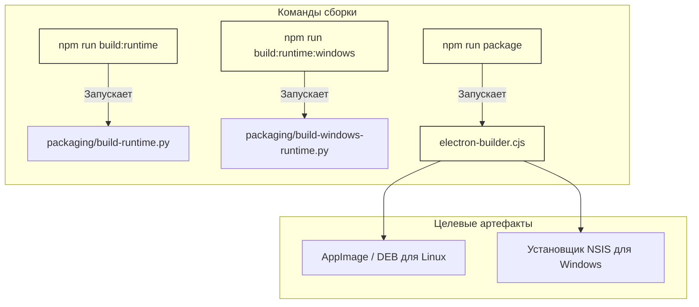
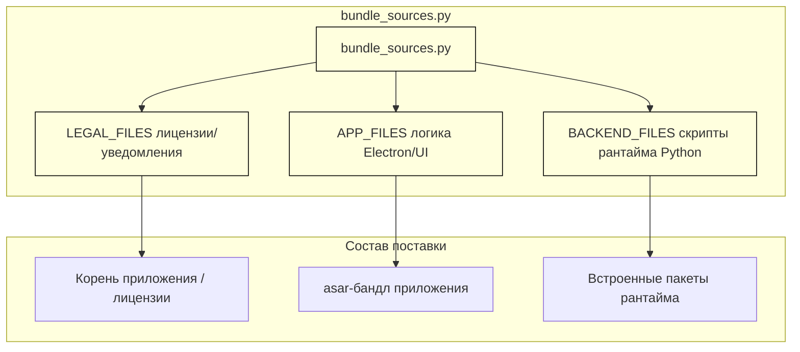

# Упаковка и распространение десктопного приложения

Используемые исходные файлы

Для генерации этой страницы вики использовались следующие файлы:

- [desktop/package-lock.json](desktop/package-lock.json)
- [desktop/package.json](desktop/package.json)
- [desktop/packaging/build-windows-runtime.py](desktop/packaging/build-windows-runtime.py)
- [desktop/packaging/bundle_sources.py](desktop/packaging/bundle_sources.py)
- [desktop/window-chrome.css](desktop/window-chrome.css)
- [desktop/window-chrome.js](desktop/window-chrome.js)
- [docs/THIRD_PARTY_NOTICES.md](docs/THIRD_PARTY_NOTICES.md)
- [docs/licenses/OPENCODE-ICON-LICENSE.txt](docs/licenses/OPENCODE-ICON-LICENSE.txt)
- [factory/web_ui/static/app.js](factory/web_ui/static/app.js)

Подсистема упаковки и распространения десктопного приложения отвечает за бандлинг основанного на Electron главного процесса, ресурсов веб-UI, компонентов нативного кода и встроенного изолированного рантайма Python в готовые к эксплуатации пакеты (установщики `.deb`, `.AppImage` и `.nsis`). На этой странице описаны конфигурационные скрипты, allowlist'ы, сборщики рантайма и конвейеры генерации артефактов.

---

## Назначение и область охвата

Упаковка десктопа охватывает преобразование репозиториев исходников в самодостаточные десктопные бинарники для Linux и Windows. Она объединяет компиляцию зависимостей Node.js (`electron-builder`), клонирование окружения Python (`uv`), встраивание нативных бинарников (таких как `ripgrep` и адаптеры process pipe для Windows) и генерацию манифестов, чтобы обеспечить безопасные и детерминированные сборки.

Источники: `desktop/package.json:1-14()`, `desktop/packaging/bundle_sources.py:1-26()`

---

## 1. Конфигурация electron-builder и скрипты сборки

Десктопный воркспейс управляется файлом `desktop/package.json`, который определяет скрипты для разработки, сборки нативного рантайма и финальной упаковки через `electron-builder` [desktop/package.json:1-14()].

*Рисунок 1: Путь скриптов сборки десктопа к генерации артефактов.*

Источники: `desktop/package.json:1-14()`

---

## 2. Allowlist'ы исходников приложения (`bundle_sources.py`)

Чтобы посторонние файлы сборки, тесты или чувствительная локальная конфигурация не просочились в продакшн-дистрибутивы, все упаковываемые исходники строго контролируются через `desktop/packaging/bundle_sources.py`. Файл определяет константы-кортежи для юридических уведомлений (`LEGAL_FILES`), скриптов фронтенда и ядра Electron (`APP_FILES`) и исполняемых скриптов Python-бэкенда (`BACKEND_FILES`) [desktop/packaging/bundle_sources.py:1-26()].

*Рисунок 2: Сопоставление allowlist'ов исходников со структурой дистрибутива.*

Источники: `desktop/packaging/bundle_sources.py:1-26()`

---

## 3. Рантаймы платформ и компиляция зависимостей

Полезная нагрузка рантайма Python собирается динамически в зависимости от целевой платформы. Для целей Windows `desktop/packaging/build-windows-runtime.py` скачивает зафиксированный CPython embed-дистрибутив (`3.14.4`), экспортирует зафиксированные требования с помощью `uv`, компилирует wheel проекта и бандлит вспомогательные инструменты вроде `ripgrep` и адаптеров Windows pipe [desktop/packaging/build-windows-runtime.py:1-92()].

### Ключевые шаги конвейера в `build-windows-runtime.py`:
1. **Валидация**: подтверждает, что `.python-version` совпадает с жёстко заданным `PYTHON_VERSION`, и проверяет контрольные суммы SHA256 [desktop/packaging/build-windows-runtime.py:26-40()].
2. **Экспорт зависимостей**: запускает `uv export --frozen --no-dev --no-emit-project` для генерации строгого списка requirements [desktop/packaging/build-windows-runtime.py:47-49()].
3. **Компиляция wheel**: вызывает `tools/build_wheel.py` для сборки wheel-пакета `igorek_agent_factory` и захвата его provenance JSON [desktop/packaging/build-windows-runtime.py:54-65()].
4. **Бандлинг инструментов**: скачивает `ripgrep`, компилирует адаптеры именованных каналов Windows через `build-windows-pipes.py` и записывает подробный `manifest.json` с хэшами всех компонентов [desktop/packaging/build-windows-runtime.py:69-91()].

Источники: `desktop/packaging/build-windows-runtime.py:24-92()`

---

## 4. Артефакты дистрибуции: DEB, AppImage и NSIS

Electron-builder упаковывает собранное дерево приложения в нативные установщики в зависимости от окружения хоста:
* **Linux**: производит пакеты `.deb` для окружений Debian/Ubuntu и самодостаточные бандлы `.AppImage`, содержащие политики песочницы и обёртки рантайма.
* **Windows**: производит исполняемые установщики `.nsis`, которые распаковывают бинарники Electron, создают ярлыки в меню «Пуск» и разворачивают изолированное окружение Python вместе с необходимыми DLL и нативными хуками.

Источники: `desktop/package.json:12-12()`, `docs/THIRD_PARTY_NOTICES.md:41-43()`

---

## 5. Установка политик песочницы и соответствие сторонним лицензиям

Пакеты должны включать полные юридические уведомления и перечни лицензий сторонних компонентов. Компоненты вроде `xterm.js`, `highlight.js`, `SheetJS`, Microsoft Detours и бандленных модулей Python зафиксированы в `docs/THIRD_PARTY_NOTICES.md` [docs/THIRD_PARTY_NOTICES.md:1-88()]. 

Во время упаковки эти юридические файлы бандлятся в целевой каталог дистрибутива, чтобы сохранить соответствие исходным лицензиям MIT, Apache-2.0 и BSD.

Источники: `docs/THIRD_PARTY_NOTICES.md:1-44()`
