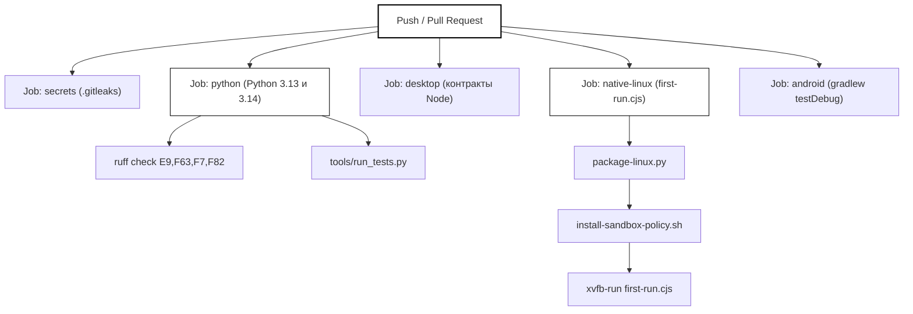
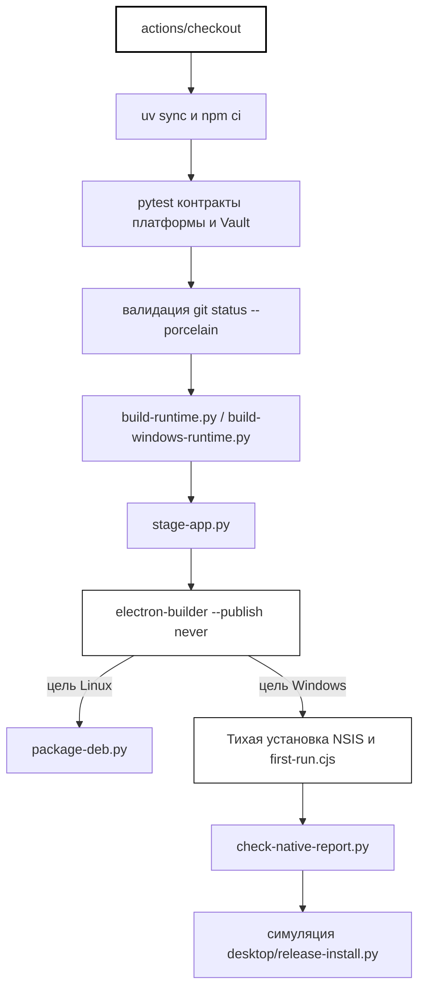

# CI-workflow и проверки публикации

Используемые исходные файлы

Для генерации этой страницы вики использовались следующие файлы:

- [.gitattributes](.gitattributes)
- [.github/dependabot.yml](.github/dependabot.yml)
- [.github/workflows/ci.yml](.github/workflows/ci.yml)
- [.github/workflows/desktop-build.yml](.github/workflows/desktop-build.yml)
- [.gitignore](.gitignore)
- [.gitleaks.toml](.gitleaks.toml)
- [desktop/agent_runtime.py](desktop/agent_runtime.py)
- [desktop/tests/helpers/private-permissions.cjs](desktop/tests/helpers/private-permissions.cjs)
- [docs/TESTING.md](docs/TESTING.md)
- [tests/test_publication_contracts.py](tests/test_publication_contracts.py)
- [tests/test_publication_git_config.py](tests/test_publication_git_config.py)
- [tools/check_publication.py](tools/check_publication.py)

## Назначение и область охвата
На этой странице описаны workflow непрерывной интеграции (CI), автоматизированные проверки публикации, системы обнаружения секретов и политики сопровождения зависимостей, реализованные в кодовой базе Igorek-Harness. Она охватывает основные workflow GitHub Actions (`.github/workflows/ci.yml` и `.github/workflows/desktop-build.yml`), харнесс валидации публикации и документации (`tools/check_publication.py`), сканирование секретов (`.gitleaks.toml`) и автоматизированное управление зависимостями (`.github/dependabot.yml`).

Источники: [`.github/workflows/ci.yml:1-162](), [`.github/workflows/desktop-build.yml:1-134](), [`tools/check_publication.py:1-113](), [`.github/dependabot.yml:1-44](), [`.gitleaks.toml:1-26]()

---

## 1. Основной конвейер CI (`ci.yml`)

Основной конвейер интеграции определён в `.github/workflows/ci.yml`. Он запускается на каждый pull request и push в `main` с минимальными правами репозитория (`contents: read`) и настроенной отменой параллельных запусков [.github/workflows/ci.yml:1-15]().

Конвейер выполняет пять основных задач (job):
1. **`secrets`**: клонирует репозиторий с полной историей (`fetch-depth: 0`) и запускает `gitleaks` по текущему дереву и всем историческим коммитам [.github/workflows/ci.yml:17-37]().
2. **`python`**: работает на ветках матрицы Python `3.13` и `3.14` на `ubuntu-24.04`. Устанавливает системные зависимости (`apparmor`, `bubblewrap`, `qemu-utils`, `ripgrep`, `openssl`, `xvfb`, `python3-gi`, `gir1.2-gtk-4.0`), настраивает профили AppArmor для непривилегированных пользовательских namespace в `bwrap`, синхронизирует зафиксированные dev-зависимости через `uv`, запускает проверки синтаксиса `ruff` и исполняет `tools/run_tests.py` внутри сессии `xvfb` [.github/workflows/ci.yml:38-85]().
3. **`desktop`**: выполняет контракты десктопных тестов на Node на `ubuntu-24.04` и `windows-2025` через `npm --prefix desktop test` [.github/workflows/ci.yml:87-106]().
4. **`native-linux`**: собирает офлайн-снапшот Linux-десктопа, настраивает политики песочницы через `install-sandbox-policy.sh` и запускает `desktop/tests/native/first-run.cjs` под `xvfb-run`, чтобы проверить реальное взаимодействие с бэкендом и инициализацию UI [.github/workflows/ci.yml:107-156]().
5. **`android`**: выполняет модульные тесты Gradle, проверки lint и debug-сборку модуля Android-клиента [.github/workflows/ci.yml:158-204]().

*Рисунок 1: Карта архитектуры путей выполнения конвейера CI GitHub Actions.*

Источники: [`.github/workflows/ci.yml:1-205]()

---

## 2. Упаковка десктопа и нативная приёмка (`desktop-build.yml`)

Workflow упаковки десктопа `.github/workflows/desktop-build.yml` отвечает за кроссплатформенные сборки дистрибутивов для `linux-x64` (`ubuntu-24.04`) и `windows-x64` (`windows-2025`) [.github/workflows/ci.yml:18-31]().

### Шаги жизненного цикла упаковки
1. **Синхронизация зафиксированных зависимостей**: устанавливает зависимости с помощью `uv sync --locked --dev` и `npm --prefix desktop ci` [.github/workflows/desktop-build.yml:50-53]().
2. **Контракты платформ**: запускает целевые наборы Python-тестов контрактов (`tests/test_platform_support.py`, `tests/test_vault_lifecycle.py`, `tests/test_checkpoint_process.py`, `tests/test_release_install.py`) с отчётом о покрытии по ветвям [.github/workflows/desktop-build.yml:54-58]().
3. **Проверка чистоты исходников**: использует хелпер `git_output('status', '--porcelain')` из `tools/build_wheel.py`, чтобы гарантировать отсутствие незакоммиченных изменений в checkout релиза [.github/workflows/desktop-build.yml:59-69]().
4. **Генерация полезной нагрузки рантайма**:
   - На Windows: выполняется `desktop/packaging/build-windows-runtime.py` [.github/workflows/desktop-build.yml:72-73]().
   - На Linux: выполняется `desktop/packaging/build-runtime.py` [.github/workflows/desktop-build.yml:74-76]().
5. **Раскладка приложения**: запускает `desktop/packaging/stage-app.py`, чтобы разложить рантайм Python и бандлы исходников по целевой структуре дистрибутива [.github/workflows/desktop-build.yml:77-80]().
6. **Electron Builder**: вызывает `npx electron-builder --config electron-builder.cjs` с `--publish never` [.github/workflows/desktop-build.yml:81-86]().
7. **Приёмка для конкретных платформ**:
   - **Linux**: собирает собственный DEB-кандидат через `package-linux.py` и `package-deb.py` [.github/workflows/desktop-build.yml:87-94]().
   - **Windows**: выполняет тихую установку (`/S`) сгенерированного NSIS-установщика, запускает нативные приёмочные скрипты Windows (`desktop/tests/native/first-run.cjs`), валидирует отчёт тестов с помощью `check-native-report.py` и имитирует процесс самообновления через `desktop/release-install.py` [.github/workflows/desktop-build.yml:95-134]().

*Рисунок 2: Конвейер упаковки десктопа, нативной валидации и симуляции обновления.*

Источники: [`.github/workflows/desktop-build.yml:1-134]()

---

## 3. Контракты публикации и проверки безопасности (`tools/check_publication.py`)

Проверки контрактов публикации обеспечиваются `tools/check_publication.py` и тестируются через `tests/test_publication_contracts.py` и `tests/test_publication_git_config.py`.

### Ключевые правила публикации
- **Валидация публичного состава**: гарантирует, что локальные артефакты сборки, файлы баз данных (`.db`, `.sqlite`, `.sqlite3`), хранилища ключей (`.jks`, `.keystore`, `.p12`, `.pfx`) и приватные папки (`Archive/`, `docs/local/`) никогда не попадают в публичный wheel или дистрибутив [tools/check_publication.py:70-77]().
- **Целостность ссылок в документации**: разбирает все файлы Markdown (`.md`) на предмет относительных ссылок `\]\(([^\s)]+)\)`, проверяя, что цели корректно разрешаются внутри корня репозитория без битых или непереносимых путей [tools/check_publication.py:85-96]().
- **Контроль языка комментариев**: сканирует исходники на Python, JavaScript, TypeScript, Kotlin, Bash, HTML, XML и TOML на наличие кириллицы в комментариях или docstring [tools/check_publication.py:15-101]().
  - Комментарии Python разбираются через `tokenize.generate_tokens` и извлечение docstring из AST [tools/check_publication.py:28-36]().
  - Для остальных языков используются парсеры `tree_sitter_language_pack`, находящие узлы комментариев и игнорирующие сторонние vendor-каталоги, такие как `factory/web_ui/static/vendor/` и `android/.../terminal/xterm.js` [tools/check_publication.py:37-61]().
- **Маркеры приватной рабочей станции**: помечает незамаскированные абсолютные пути получателя или рабочей станции, совпадающие с `PRIVATE_MARKERS` (например, конкретные каталоги `/home/`) [tools/check_publication.py:16-84]().

Источники: [`tools/check_publication.py:1-113](), [`tests/test_publication_contracts.py:1-83](), [`tests/test_publication_git_config.py:1-137]()

---

## 4. Сопровождение зависимостей и сканирование секретов

### Конфигурация Dependabot
Автоматические обновления зависимостей настроены в `.github/dependabot.yml` [.github/dependabot.yml:1-43](). Отслеживаются четыре экосистемы по недельному расписанию с лимитом в 3 открытых pull request на экосистему:
1. `github-actions` (`directory: /`) [.github/dependabot.yml:3-7]()
2. `uv` (`directory: /`), с группировкой рутинных обновлений minor/patch и исключением `tree-sitter` и `tree-sitter-language-pack` [.github/dependabot.yml:13-23]()
3. `npm` (`directory: /desktop`) [.github/dependabot.yml:24-33]()
4. `gradle` (`directory: /android`) [.github/dependabot.yml:34-43]()

### Обнаружение секретов (`.gitleaks.toml`)
Сканирование секретов настроено через `.gitleaks.toml`, который расширяет детекторы Gitleaks по умолчанию [.gitleaks.toml:1-4]() и задаёт строгие allowlist'ы для:
- исторических синтетических smoke-фикстур Tavily (`factory/core/smoke_vault.py`) [.gitleaks.toml:6-12]()
- присваиваний булевых состояний UI (`desktop/owner-ui.js`) [.gitleaks.toml:13-19]()
- бандленных сторонних библиотек `xterm.js` [.gitleaks.toml:20-25]()

Источники: [`.github/dependabot.yml:1-44](), [`.gitleaks.toml:1-26]()
