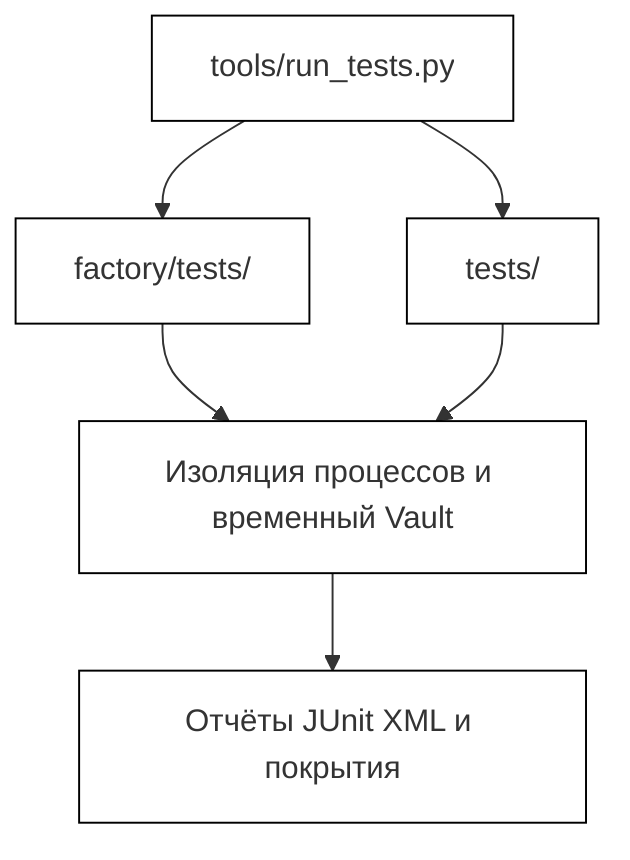
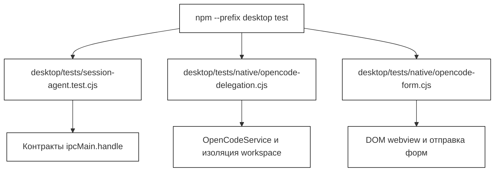
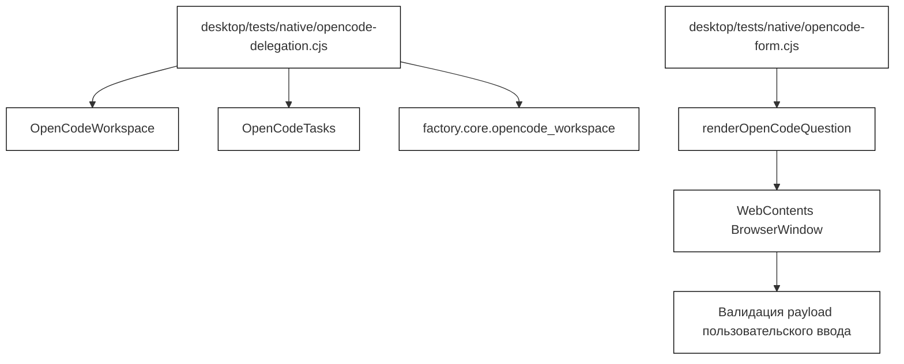
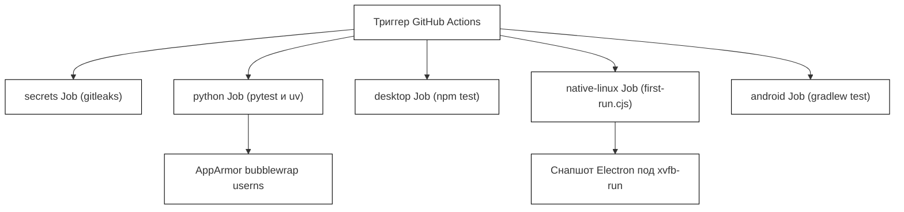

# Наборы тестов и нативные приёмочные прогоны

Используемые исходные файлы

Для генерации этой страницы вики использовались следующие файлы:

- [.github/workflows/ci.yml](.github/workflows/ci.yml)
- [.gitignore](.gitignore)
- [.gitleaks.toml](.gitleaks.toml)
- [desktop/tests/helpers/private-permissions.cjs](desktop/tests/helpers/private-permissions.cjs)
- [desktop/tests/native/opencode-delegation.cjs](desktop/tests/native/opencode-delegation.cjs)
- [desktop/tests/native/opencode-form.cjs](desktop/tests/native/opencode-form.cjs)
- [desktop/tests/session-agent.test.cjs](desktop/tests/session-agent.test.cjs)
- [docs/TESTING.md](docs/TESTING.md)
- [docs/development/TestLOG.md](docs/development/TestLOG.md)

На этой странице описана инфраструктура тестирования и приёмочной верификации Igorek-Harness: наборы Python-тестов, десктопные Node-тесты, нативные приёмочные скрипты Electron (`first-run.cjs`, `opencode-delegation.cjs`, `opencode-form.cjs`, `update-flow.cjs`), автоматизация CI и журнал релизов `TestLOG`.

Источники: `docs/TESTING.md:1-124` [docs/TESTING.md:1-123](), `docs/development/TestLOG.md:1-109` [docs/development/TestLOG.md:1-109]()

---

## 1. Тестовая инфраструктура Python (`tests/` и `factory/tests/`)

Тесты Python-бэкенда обнаруживаются и оркестрируются через `tools/run_tests.py`, который выделяет каждому тестовому файлу свежий процесс операционной системы и приватный временный корень данных [docs/TESTING.md:17-18](). Раннер применяет дедлайны выполнения на тест и на файл, экспортирует артефакты JUnit XML и объединяет отчёты о покрытии по ветвям между модулями [docs/TESTING.md:18-19]().

Корневая конфигурация `pytest` явно изолирует обычный сбор тестов pytest от реальных домашних каталогов, хранилищ учётных данных Vault и унаследованных переменных окружения [docs/TESTING.md:23-25](). Фикстуры предоставляют собственные mock-аккаунты, ключи и loopback-сервисы [docs/TESTING.md:24-25](). Опциональные системные предпосылки (такие как `bubblewrap` или возможности KVM) проверяются динамически, и их отсутствие даёт явную причину пропуска, а не падение теста [docs/TESTING.md:25-26]().

*Рисунок 1: Конвейер обнаружения и выполнения тестов Python.*

Источники: `docs/TESTING.md:17-26` [docs/TESTING.md:17-26]()

---

## 2. Десктопные Node- и контрактные тесты (`desktop/tests/`)

Десктопные тесты живут в `desktop/tests/` и выполняются через тестовый раннер Node (`npm --prefix desktop test`) [docs/TESTING.md:28-30](). Эти контрактные тесты проверяют обработчики IPC, автоматы состояний главного процесса, проверки разрешений и сериализацию транспорта, не поднимая видимость нативного окна и не рендеря пиксели [docs/TESTING.md:30-31]().

Например, автомат состояний агента сессии валидируется модульными харнессами, которые подменяют Electron `ipcMain` и рантайм владельца [desktop/tests/session-agent.test.cjs:1-7](). Аналогично хелперы приватных разрешений гарантируют, что создаваемые файлы и сокеты имеют строгие ACL или POSIX-режимы `0o600` [desktop/tests/helpers/private-permissions.cjs:1-26]().

*Рисунок 2: Архитектура набора десктопных Node-тестов.*

Источники: `docs/TESTING.md:28-31` [docs/TESTING.md:28-31](), `desktop/tests/session-agent.test.cjs:1-7` [desktop/tests/session-agent.test.cjs:1-7](), `desktop/tests/helpers/private-permissions.cjs:1-26` [desktop/tests/helpers/private-permissions.cjs:1-26]()

---

## 3. Нативные приёмочные скрипты Electron

Нативные приёмочные прогоны проверяют полную интеграцию десктопа, запуская упакованные бинарники Electron под `xvfb-run` с синтетическим loopback AI-провайдером [docs/TESTING.md:109-117]().

### `opencode-delegation.cjs`
Этот скрипт проверяет независимые фоновые задачи кодинга OpenCode [docs/development/TestLOG.md:5-10](). Он инициализирует тестовый Git-репозиторий, готовит изолированный снапшот workspace с помощью `factory.core.opencode_workspace` [desktop/tests/native/opencode-delegation.cjs:24-28](), поднимает локальный HTTP-провайдер Server-Sent Events (SSE) [desktop/tests/native/opencode-delegation.cjs:44-71]() и убеждается, что shell-инструменты, записи файлов и вопросы безопасно исполняются внутри песочницы копии [desktop/tests/native/opencode-delegation.cjs:50-57]().

### `opencode-form.cjs`
Этот скрипт тестирует нативный рендеринг форм внутри изолированного экземпляра `BrowserWindow` [desktop/tests/native/opencode-form.cjs:5-10](). Он загружает собранный бандл веб-приложения, выполняет `renderOpenCodeQuestion` с условными зависимостями полей (клаузами `when`), изменяет поля формы (строки, числа, чекбоксы multiselect) и подтверждает, что доверенные payload'ы нативной отправки соответствуют ожидаемым структурам схемы [desktop/tests/native/opencode-form.cjs:13-40]().

*Рисунок 3: Соответствие нативных приёмочных скриптов сущностям кода.*

Источники: `docs/TESTING.md:109-117` [docs/TESTING.md:109-117](), `desktop/tests/native/opencode-delegation.cjs:1-95` [desktop/tests/native/opencode-delegation.cjs:1-95](), `desktop/tests/native/opencode-form.cjs:1-47` [desktop/tests/native/opencode-form.cjs:1-46]()

---

## 4. Журнал релизов TestLOG (`docs/development/TestLOG.md`)

Журнал релизов `TestLOG.md` фиксирует точные метрики выполнения для релиз-кандидатов. Он явно разделяет собранные тест-кейсы, прошедшие подтесты, проценты покрытия кода по операторам/ветвям, пропуски по платформам и заметки о выполнении на физических устройствах/KVM [docs/development/TestLOG.md:17-34]().

Ключевые метрики, отслеживаемые для каждого релиз-кандидата:
* **Числа собранных и прошедших тестов:** различают полный изолированный сбор в корне Python и десктопные Node-наборы [docs/development/TestLOG.md:23-26]().
* **Покрытие кода:** измерения покрытия по операторам и ветвям для ядра Python и модулей инференса [docs/development/TestLOG.md:29-31]().
* **Пропуски по платформам:** явная категоризация недоступных или опциональных аппаратных окружений (таких как KVM, vsock, сборщики образов и специфичные для Windows файловые контракты) [docs/development/TestLOG.md:31-34]().

Источники: `docs/development/TestLOG.md:1-109` [docs/development/TestLOG.md:1-109]()

---

## 5. Конвейер выполнения CI (`.github/workflows/ci.yml`)

Конвейер CI GitHub Actions обеспечивает автоматизированную верификацию в независимых задачах [non-cited: .github/workflows/ci.yml]():
1. **`secrets`**: запускает `gitleaks` по текущему дереву и всей истории git с правилами `.gitleaks.toml`, не раскрывая значений учётных данных [.github/workflows/ci.yml:17-37]().
2. **`python`**: выполняет тесты на нескольких версиях Python (`3.13`, `3.14`) на Ubuntu 24.04 с фиксацией зависимостей через `uv` [.github/workflows/ci.yml:38-86](). Настраивает профили AppArmor для bubblewrap (`igorek-ci-bwrap`), разрешающие непривилегированные пользовательские namespace во время контейнеризованных тестов песочницы [.github/workflows/ci.yml:57-67]().
3. **`desktop`**: валидирует десктопные контракты на раннерах Linux (`ubuntu-24.04`) и Windows (`windows-2025`) [.github/workflows/ci.yml:87-106]().
4. **`native-linux`**: упаковывает приложение Electron и выполняет `desktop/tests/native/first-run.cjs` под `xvfb-run` с включёнными переносимыми политиками AppArmor [.github/workflows/ci.yml:107-157]().
5. **`android`**: выполняет модульные тесты Gradle, проверки lint и debug-сборки [.github/workflows/ci.yml:158-162]().

*Рисунок 4: Зависимости и порядок выполнения job'ов CI.*

Источники: `.github/workflows/ci.yml:1-162` [.github/workflows/ci.yml:1-162]()
