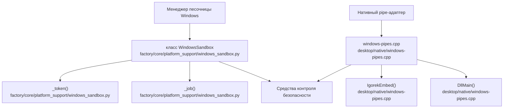
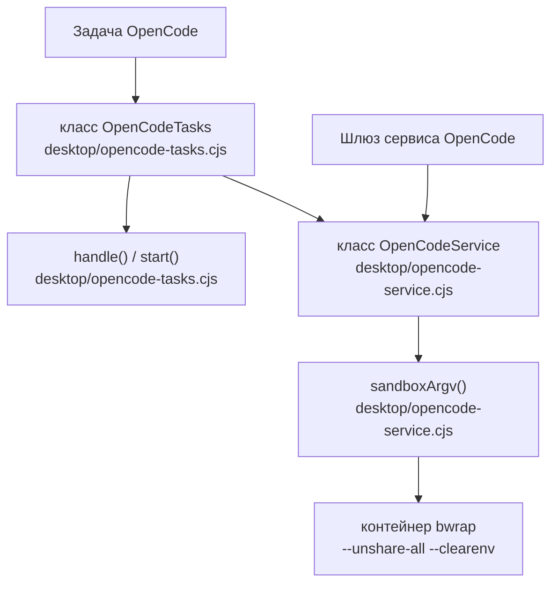

# Глоссарий

Используемые исходные файлы

Для генерации этой страницы вики использовались следующие файлы:

- [desktop/native/windows-pipes.cpp](desktop/native/windows-pipes.cpp)
- [desktop/opencode-service.cjs](desktop/opencode-service.cjs)
- [desktop/opencode-tasks.cjs](desktop/opencode-tasks.cjs)
- [docs/PROJECT_LAYOUT.md](docs/PROJECT_LAYOUT.md)
- [docs/architecture/ISOLATION.md](docs/architecture/ISOLATION.md)
- [docs/architecture/POLICY.md](docs/architecture/POLICY.md)
- [docs/architecture/RICH_CLI_RENDERING_EXPLAINED.md](docs/architecture/RICH_CLI_RENDERING_EXPLAINED.md)
- [docs/development/CROSS_PLATFORM_DESKTOP.md](docs/development/CROSS_PLATFORM_DESKTOP.md)
- [docs/development/FIRST_RUN_ACCEPTANCE.md](docs/development/FIRST_RUN_ACCEPTANCE.md)
- [docs/development/TestLOG.md](docs/development/TestLOG.md)
- [factory/core/cc_backend_executor.py](factory/core/cc_backend_executor.py)
- [factory/core/cc_backend_trace.py](factory/core/cc_backend_trace.py)
- [factory/core/openai_responses.py](factory/core/openai_responses.py)
- [factory/core/platform_support/windows_sandbox.py](factory/core/platform_support/windows_sandbox.py)
- [pyproject.toml](pyproject.toml)
- [tests/test_openai_responses.py](tests/test_openai_responses.py)

## Назначение и область охвата

На этой странице определены специфичные для кодовой базы термины, архитектурные абстракции, примитивы безопасности и компоненты подсистем, используемые в репозитории `Endorpheen/Igorek-Harness`. Каждая статья содержит технические детали реализации, характеристики потоков данных, ключевые функции и классы, а также точные указатели на файлы.

---

## Основные определения и технический справочник

### AgentRuntime
* **Определение**: Основное состояние выполнения и движок фоновых воркеров, который управляет циклами многоходового выполнения агента, диспетчеризацией инструментов и сохранением состояния [docs/PROJECT_LAYOUT.md:8-10]().
* **Реализация и поток данных**: Рантайм разрешает параметры задачи, инициализирует цикл выполнения модели в `factory/core/cc_backend_executor.py`, обрабатывает одобрения инструментов через `factory/core/cc_backend_tools.py` и записывает журналы событий и состояние сессии в локальную базу данных [factory/core/cc_backend_executor.py:1-7]().

Источники: [docs/PROJECT_LAYOUT.md:6-10](), [factory/core/cc_backend_executor.py:1-7]()

### bwrap (Bubblewrap)
* **Определение**: Непривилегированная утилита песочницы, используемая на Linux-хостах для изоляции фоновых экземпляров сервиса OpenCode и сессий выполнения [desktop/opencode-service.cjs:26-46]().
* **Реализация и поток данных**: Конструктор десктопного сервиса OpenCode собирает строгий вектор аргументов через `sandboxArgv()` в `desktop/opencode-service.cjs`, передавая флаги вроде `--unshare-all`, `--die-with-parent`, `--clearenv` и сбросы возможностей, чтобы ограничить доступ к файловой системе и сети перед запуском `/opt/igorek/opencode-sandbox.py` [desktop/opencode-service.cjs:26-46]().

Источники: [desktop/opencode-service.cjs:26-46]()

### Capability SID
* **Определение**: Уникальный идентификатор безопасности (SID), генерируемый динамически для ограничения токенов доступа дочерних процессов Windows [factory/core/platform_support/windows_sandbox.py:83-83]().
* **Реализация и поток данных**: `WindowsSandbox` генерирует capability-строку с префиксом `S-1-5-21-` из криптостойких случайных битов и применяет явные DACL-разрешения, чтобы записи в workspace задания оставались изолированными и одноразовыми [factory/core/platform_support/windows_sandbox.py:57-95]().

Источники: [factory/core/platform_support/windows_sandbox.py:57-95]()

### Compaction (компакция)
* **Определение**: Механизм снижения давления на контекстное окно путём суммаризации старой истории сообщений и архивирования состояний сессии [factory/core/cc_backend_executor.py:43-52]().
* **Реализация и поток данных**: Оценивает токенное давление (`evaluate_compaction_pressure`), формирует компактные массивы сообщений (`build_compacted_messages`), суммаризирует историю через `summarize_history()` и записывает артефакты ручной или реактивной компакции [factory/core/cc_backend_executor.py:43-52]().

Источники: [factory/core/cc_backend_executor.py:43-52]()

### Egress Server (egress-сервер)
* **Определение**: Сетевой прокси-компонент, регулирующий и фильтрующий исходящие запросы из песочниценных сред воркеров [desktop/opencode-service.cjs:10-10]().
* **Реализация и поток данных**: Реализован в `desktop/opencode-egress.cjs`; перехватывает трафик HTTP/HTTPS от песочниценных дочерних процессов, чтобы принудительно применять строгие allowlist'ы доменов и предотвращать несанкционированную утечку данных.

Источники: [desktop/opencode-service.cjs:1-11]()

### Host Services (хост-сервисы)
* **Определение**: Локальные сервисы моста Model Context Protocol (MCP) или API, доступные песочниценным экземплярам воркеров OpenCode через защищённые Unix- или именованные каналы [desktop/opencode-service.cjs:37-42]().
* **Реализация и поток данных**: `sandboxArgv()` монтирует сокет хост-сервисов (`/run/igorek-host-services.sock`), токен верификации и `host-services-client.py` внутри namespace контейнера, настраивая профиль MCP-сервера, который безопасно отображает локальные инструменты [desktop/opencode-service.cjs:37-42]().

Источники: [desktop/opencode-service.cjs:26-46]()

### Job Object (объект задания)
* **Определение**: Примитив изоляции ядра Windows, используемый для управления и ограничения времени жизни, потребления памяти и дерева процессов запущенных дочерних процессов [factory/core/platform_support/windows_sandbox.py:36-46]() [factory/core/platform_support/windows_sandbox.py:94-94]().
* **Реализация и поток данных**: `WindowsSandbox._job()` создаёт и назначает лимиты процессов (`JobBasic`, `JobExtended`), чтобы гарантировать одновременное завершение всех потомков при закрытии хэндла песочницы [factory/core/platform_support/windows_sandbox.py:36-46]() [factory/core/platform_support/windows_sandbox.py:94-94]().

Источники: [factory/core/platform_support/windows_sandbox.py:36-46](), [factory/core/platform_support/windows_sandbox.py:94-94]()

### Managed Mode / Owned Runtime (управляемый режим / собственный рантайм)
* **Определение**: Режим работы, при котором процесс-контейнер Electron-десктопа запускает, контролирует и управляет жизненным циклом лежащего в основе Python-бэкенда [docs/PROJECT_LAYOUT.md:21-22]() [docs/PROJECT_LAYOUT.md:33-35]().
* **Реализация и поток данных**: `desktop/main.cjs` и `desktop/runtime.cjs` управляют последовательностью запуска бэкенда, каналами IPC-взаимодействия, опросом готовности и сценариями автоматического восстановления или перезапуска.

Источники: [docs/PROJECT_LAYOUT.md:21-22](), [docs/PROJECT_LAYOUT.md:33-35]()

### Mobile Bridge (мобильный мост)
* **Определение**: Аутентифицированный шлюз HTTP и WebSocket, обеспечивающий связь между UI-клиентами Android/мобильных устройств и бэкендом ядра Python [docs/PROJECT_LAYOUT.md:11-11]() [docs/PROJECT_LAYOUT.md:34-34]().
* **Реализация и поток данных**: `factory/core/mobile_bridge/service.py` предоставляет API сессий, эндпоинты сопряжения устройств и безопасные обработчики доступа к файлам, поддерживающие взаимодействие с агентом с мобильных устройств.

Источники: [docs/PROJECT_LAYOUT.md:11-11](), [docs/PROJECT_LAYOUT.md:34-34]()

### OpenCode Assignment & Run ID (задача OpenCode и run ID)
* **Определение**: Независимая песочниценная фоновая задача кодинга, делегированная экземпляру сервиса OpenCode и однозначно отслеживаемая 32-символьным шестнадцатеричным идентификатором запуска (`run_id`, соответствующим `oc_[a-f0-9]{32}`) [docs/development/TestLOG.md:3-8]() [desktop/opencode-tasks.cjs:35-41]().
* **Реализация и поток данных**: Управляются классом `OpenCodeTasks` в `desktop/opencode-tasks.cjs`; задачи получают изолированные каталоги workspace, принимают вопросы и отправки форм от пользователя и по завершении планируют доставку результата за один ход обратно в основную сессию чата [docs/development/TestLOG.md:3-15]() [desktop/opencode-tasks.cjs:30-86]().

Источники: [docs/development/TestLOG.md:3-15](), [desktop/opencode-tasks.cjs:30-86]()

### Pipe Adapter (pipe-адаптер)
* **Определение**: Механизм нативной DLL-инъекции для Windows с использованием Microsoft Detours, перехватывающий создание именованных каналов и запуск процессов и обеспечивающий корректное наследование DACL по умолчанию [desktop/native/windows-pipes.cpp:1-64]().
* **Реализация и поток данных**: `windows-pipes.cpp` перехватывает `CreateNamedPipeA/W` и `CreateProcessA/W`, применяя структуры `PipeSecurity`, построенные из DACL по умолчанию токена текущего потока, до инициализации дочернего процесса через `IgorekEmbed` [desktop/native/windows-pipes.cpp:1-120]().

Источники: [desktop/native/windows-pipes.cpp:1-120]()

### Transit Grant (транзитный доступ)
* **Определение**: Временные аренды файловой системы или разрешений, создаваемые при инициализации песочницы для безопасного копирования workspace и проверки результатов [factory/core/platform_support/windows_sandbox.py:77-86]().
* **Реализация и поток данных**: Управляются внутри `WindowsSandbox.__init__`; транзитные списки отслеживают временные дескрипторы, которые очищаются после успешной передачи или завершения песочницы [factory/core/platform_support/windows_sandbox.py:77-86]().

Источники: [factory/core/platform_support/windows_sandbox.py:57-98]()

### Trace JSONL (JSONL-трейс)
* **Определение**: Структурированные журналы трассировки в формате JSON с разделением по строкам, фиксирующие события выполнения модели, вызовы инструментов, таксономию ошибок и диагностику [factory/core/cc_backend_trace.py:1-49]().
* **Реализация и поток данных**: `append_cc_backend_trace` записывает события в файлы трассировки, а `model_failure_diagnostics` и `browser_tool_diagnostics` санитизируют и фильтруют диагностические ключи для телеметрии и отладки [factory/core/cc_backend_trace.py:1-83]().

Источники: [factory/core/cc_backend_trace.py:1-83]()

### Vault (хранилище)
* **Определение**: Подсистема зашифрованного хранения учётных данных, жизненного цикла владельца и брокера разрешений [docs/PROJECT_LAYOUT.md:9-9]().
* **Реализация и поток данных**: Расположена в `factory/core/vault/`; обрабатывает криптографическое шифрование секретов, сканирование секретов, импорт окружения и проверку разрешений для инструментов агента.

Источники: [docs/PROJECT_LAYOUT.md:9-9]()

---

## Архитектурное сопоставление: подсистема песочницы и каналов

Следующая диаграмма связывает концепции на естественном языке — менеджер песочницы Windows и безопасность каналов — с их конкретными сущностями и функциями в коде.

Источники: [factory/core/platform_support/windows_sandbox.py:57-95](), [desktop/native/windows-pipes.cpp:1-120]()

---

## Архитектурное сопоставление: подсистема делегирования OpenCode

Следующая диаграмма связывает концепции на естественном языке — делегирование задач OpenCode и контейнеризацию Bubblewrap — с соответствующими модулями и функциями Node.js.

Источники: [desktop/opencode-tasks.cjs:30-94](), [desktop/opencode-service.cjs:26-54]()
