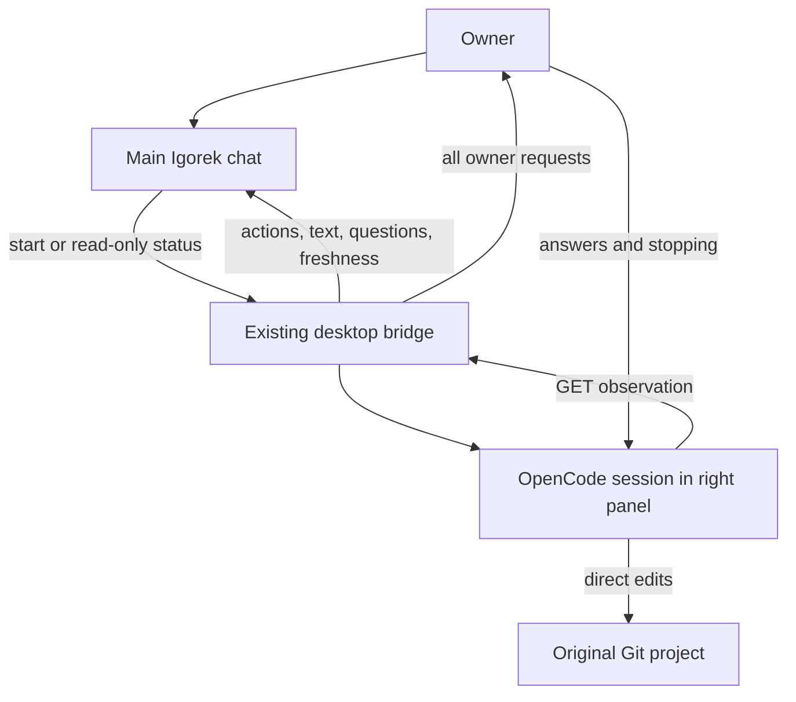

# OpenCode Delegation Subsystem

## Current behavior · 0.2.12

Linux and Windows x64 desktop can run **one explicitly requested OpenCode assignment at a time**. The main chat exposes `opencode_task` actions `start` and `status`. It cannot cancel an assignment, answer owner questions, grant permissions or steer the active OpenCode session. The owner retains the existing OpenCode controls.

OpenCode edits the **original selected Git project**. Admission checks Git membership without walking, hashing or copying project contents. There is no task clone, baseline, transfer check or apply stage. Assignment configuration forces `snapshots: false`, even if the project enables OpenCode snapshots. Service binaries, logs and caches still consume disk space. Ignored files inside a granted project can be read; credentials should be kept outside granted projects.

While the assignment writes, the main chat supports conversation and `Read`/`Grep`/`Glob`. A runtime execution guard blocks conflicting mutating tools, including forced or previously approved calls. An already running writer prevents an overlapping assignment from starting. This coordinates Igorek's tools, not unrelated editors or manual OpenCode sessions.

The session named `Поручение: <title>` opens in the existing right panel. The main chat remains available. Every form and permission request reaches the owner through the existing cards; replies use the exact run, session and request IDs. Completed public text and the final receipt arrive automatically. Detailed actions are obtained when the owner asks for progress, without a background model polling loop.

The observer returns bounded facts: ten recent and active tool calls, public assistant text, pending owner inputs, timestamps, counts and truncation flags. Failed refreshes expose the last observation as stale; absent observations are unavailable, and final ones are historical. A completed tool call does not prove that tests passed. The model must not invent stages or percentages.

Windows assignments use a restricted token at **medium** integrity, temporary project/service grants, a private desktop and a kill-on-close Job Object. Internal regular file symlinks are supported; external and directory reparse points are refused. Commands use `cmd.exe` and x64 children; PowerShell and x86 children are unsupported. Linux uses bubblewrap. KVM, Linux network namespaces and host-services MCP are not Windows features.

Owner interruption and failures retain already written edits. Closing the panel does not stop the service. Restarted runtimes mark unfinished receipts interrupted and do not relaunch them. Manual OpenCode and ChatGPT tabs retain their independent behavior.

[Current architecture and limits](https://github.com/Endorpheen/Igorek-Harness/blob/d0e210bbdb9db152c312dc2d089f0cf4f0b520d9/docs/architecture/OPENCODE_DELEGATION.md) · [Current lifecycle](5.1-OpenCodeService-and-Task-Lifecycle.md) · [Direct execution and legacy helpers](5.2-Workspace-Snapshots-and-Transfer-Check.md)
