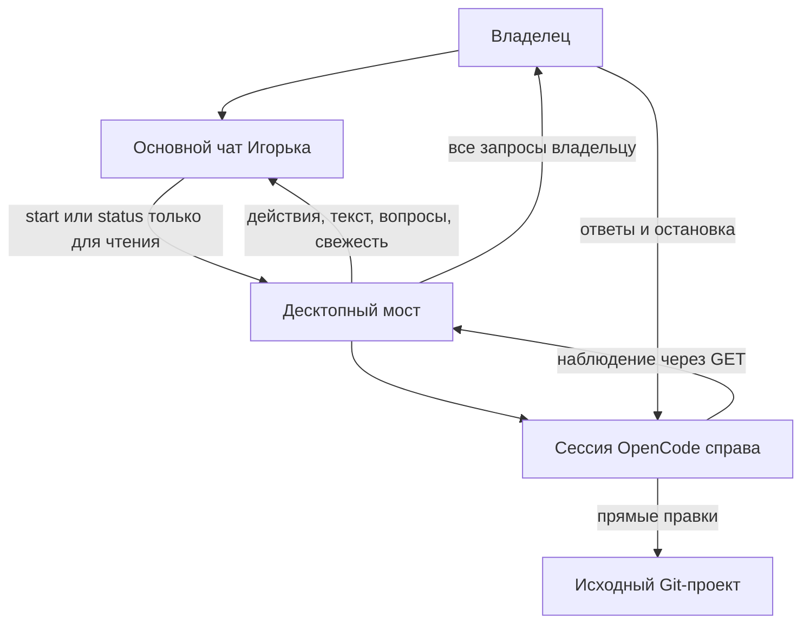

# Подсистема поручений OpenCode

## Текущее поведение · 0.2.12

Десктоп Linux и Windows x64 выполняет **одно явно запрошенное поручение OpenCode за раз**. Основному чату доступны действия `start` и `status` инструмента `opencode_task`. Через него нельзя отменить поручение, ответить за владельца, выдать разрешение или направлять активную сессию OpenCode. У владельца остаются существующие элементы управления OpenCode.

OpenCode правит **исходный выбранный Git-проект**. При запуске проверяется принадлежность к Git без обхода, хеширования или копирования содержимого проекта. Нет клона задачи, базового снимка, проверки переноса и этапа применения. Конфигурация поручения принудительно задаёт `snapshots: false`, даже если проект включает снимки OpenCode. Служебные бинарники, журналы и кеши всё равно занимают место. Игнорируемые файлы внутри разрешённого проекта доступны для чтения; секреты следует хранить за пределами разрешённых проектов.

Пока поручение пишет файлы, основной чат поддерживает разговор и `Read`/`Grep`/`Glob`. Проверка при исполнении инструментов блокирует конфликтующие изменения, включая принудительные и ранее одобренные вызовы. Уже запущенный писатель не даёт начать пересекающееся поручение. Ограничение координирует инструменты Игорька, а не внешние редакторы или ручные сессии OpenCode.

Сессия `Поручение: <title>` открывается в существующей правой панели. Основной чат остаётся доступным. Все формы и разрешения поступают владельцу через прежние карточки; ответы привязаны к точным идентификаторам запуска, сессии и запроса. Завершённые публичные тексты и итог приходят автоматически. Подробные действия запрашиваются, когда владелец спрашивает о прогрессе; фонового цикла опроса моделью нет.

Наблюдатель возвращает ограниченные факты: десять недавних и текущих вызовов инструментов, публичный текст помощника, ожидающие запросы владельцу, время наблюдения, счётчики и признаки усечения. При ошибке обновления последний снимок помечается устаревшим; отсутствие наблюдений обозначается явно, а завершённые наблюдения являются историческими. Завершённый вызов инструмента не доказывает успешность тестов. Модель не должна выдумывать этапы и проценты.

Поручения Windows используют ограниченный токен со **средним** уровнем целостности, временные разрешения проекта и службы, отдельный desktop и Job Object с остановкой дочерних процессов. Внутренние ссылки на обычные файлы поддерживаются; внешние и каталоговые reparse points запрещены. Команды используют `cmd.exe` и процессы x64; PowerShell и процессы x86 не поддерживаются. Linux использует bubblewrap. KVM, сетевые пространства имён Linux и MCP локальных сервисов не предоставляются на Windows.

Остановка владельцем и ошибки сохраняют уже записанные изменения. Закрытие панели не останавливает службу. После перезапуска runtime незавершённые записи помечаются прерванными и не запускаются заново. Ручной OpenCode и вкладки ChatGPT сохраняют независимое поведение.

[Текущая архитектура и ограничения](https://github.com/Endorpheen/Igorek-Harness/blob/d0e210bbdb9db152c312dc2d089f0cf4f0b520d9/docs/architecture/OPENCODE_DELEGATION.md) · [Жизненный цикл](5.1-OpenCodeService-and-Task-Lifecycle.md) · [Прямое выполнение и прежние функции](5.2-Workspace-Snapshots-and-Transfer-Check.md)
